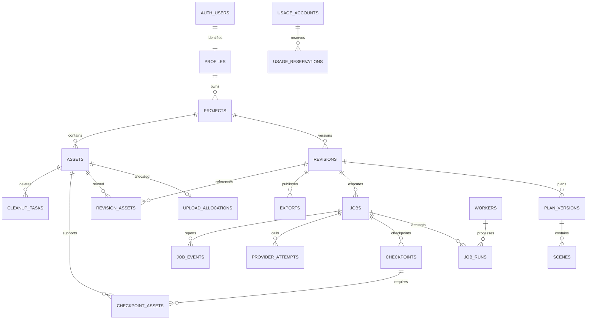
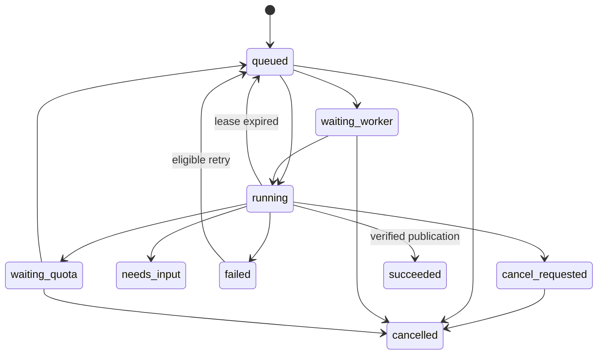

> Authentication revision approved on 24 October 2026: public email/password registration and Google sign-in; no invitations, SMTP, verification emails or password-reset emails in V1. Other product requirements remain unchanged.

# AI Video Studio — database design

**Version:** 1.1 · **Date:** 24 October 2026  
**Status:** Detailed design for review; no database or migrations have been deployed.  
**Authority:** [PRD](PRD.md) and user-approved [system architecture](SYSTEM-ARCHITECTURE.md).  
**Companion:** [API design](API-DESIGN.md). Review these together, then design the UI in Google Stitch, reconcile, and implement.

## 1. Purpose and boundaries

PostgreSQL stores users' project metadata, immutable generation requests, execution state, source references, media manifests and usage accounting. Supabase Storage stores the actual files. Supabase Auth owns password hashes, OAuth identities and login sessions. Our tables do not duplicate those secrets.

A project is the workspace; a revision is one immutable requested video; a job executes work; an asset is one stored object. A successful revision is one output card, regardless of whether it has both clean and burned-caption variants. Another orientation is a new revision and output slot. Retrying infrastructure failure resumes the same job/revision; changing content creates a new revision.

The design supports education, software and branding, English 60/75/90-second targets, both 720p orientations, seven-day media retention, three retained outputs/user, one active job/user and one global processing worker. The short software demo is not a new duration option. No music, billing, R2, Python or public gallery tables are needed.

### 1.1 How to read the schema notation

- `uuid` IDs default to a database-generated random UUID. Every table has a primary key unless a composite PK is stated.
- `ts` means UTC `timestamptz`; `created_at ts NOT NULL DEFAULT now()` is standard. Mutable tables also have `updated_at` maintained server-side.
- Fields are NOT NULL unless marked `?`. `?` means SQL NULL, not an empty string or zero.
- Bytes, event sequences, fence tokens and accumulated milliseconds use nonnegative `bigint`; API represents these as decimal strings. Durations in milliseconds use bigint; scene frame counts use integer.
- SHA-256 fields use lowercase hex text with a 64-character check. JSONB objects are bounded and validated by versioned Zod contracts; core invariants are also SQL constraints.
- State columns are checked text, not PostgreSQL enums, to permit controlled additive state migrations. No client can assign arbitrary states.
- Application tables live in `public` with RLS and explicit grants. Internal helpers live in a non-exposed `private` schema. Exposed RPCs have tightly restricted execution grants.

## 2. Entity relationships



Scope duplication is intentional: owner_id/project_id on child rows allows composite foreign keys to prevent cross-user linking. An asset belongs to one project and owner; reuse is within that project only in V1. No global deduplication that reveals another user's uploaded content.

## 3. Identity and access tables

### 3.1 `profiles`

| Column | Type/default | Meaning |
|---|---|---|
| id | uuid, PK/FK auth.users.id, ON DELETE RESTRICT | Authenticated identity |
| display_name | varchar(80) | Required trimmed 1–80-character display name; Full name UI maps here |
| role | text = tester; tester/operator | Server assigned; never derived from user_metadata |
| status | text = active; active/disabled/deleting | App authorization gate, including while a JWT still exists |
| defaults | jsonb = {} | Allowed voiceProfileId/orientation/targetSeconds preferences |
| settings_version | integer = 1, >0 | Optimistic concurrency |
| deletion_requested_at | ts? | Lifecycle tracking |

Auth email stays in Auth; there is no invitation table or enrollment token. Profile creation occurs through a controlled Auth-user trigger. Do not give users column privileges to update role/status/id. Account deletion removes app dependents before Auth deletion, avoiding accidental cascades that lose cleanup records.

### 3.2 Provider identities and OAuth flows

Supabase auth.users/auth.identities remain authoritative for user IDs and authentication methods. No custom password table, invitation table, invitation state machine or invitation index is created. A controlled Auth-user trigger creates a normal profile for either public signup method; repeated provider login must not create duplicate profiles. User metadata cannot choose operator role.

Add profiles.email_ownership text NOT NULL DEFAULT 'unknown' CHECK IN ('unknown','provider_verified') and email_ownership_identity_id text NULL. Only a trusted server synchronization of verified provider evidence may update them, and evidence must match the current Auth email. Local Confirm Email disabled is not mailbox evidence. These fields are descriptive, never permission to merge accounts; access is by immutable user ID. Do not offer email changes or credential linking/unlinking in V1.

oauth_flows: id uuid PK, owner_id uuid NULL FK profiles (NULL for login/signup), initiating_session_id uuid NULL, flow_kind text CHECK IN ('login','reauthenticate'), state_hash text UNIQUE, provider text CHECK='google', action text NULL CHECK='delete_account', expected_identity_id text NULL, return_path text (allowlisted), status text CHECK IN ('pending','completed','failed','consumed'), expires_at ts, completed_at ts NULL, created_at ts. Reauthentication requires owner/session/expected identity/action; public login does not. Store PKCE verifier using the supported secure browser-bound SDK mechanism, not plaintext in this table. No provider access/refresh tokens are stored here.

Five-minute pending lifetime; one-use state/code; index(status,expires_at) for cleanup and index(owner_id,created_at) for reauth lookup. Keep failed/completed nonsecret operational records at most 24 hours, then purge unless required for a live action grant. State transitions pending → completed/failed; completed → consumed; expired pending becomes failed. Callback validates flow, current initiating session and fresh same-identity proof before creating a reauth grant. Token refresh/account chooser alone does not prove freshness. Provider behavior is tested before enabling Google-only account deletion.

Supabase may automatically link identities sharing an email. Disabling Confirm Email implicitly confirms local email accounts in Supabase; that is not evidence of mailbox ownership. Never implement application account merging, ownership transfers or password reset based only on matching email text. Test email-first, Google-first, pre-registered victim email, existing password credentials and active sessions before enabling both methods publicly. If provider automatic-linking behavior cannot safely handle these combinations, resolve the identity isolation/linking configuration before release; a UI-only check is insufficient. Manual link/unlink and adding a password to Google-only accounts are not V1 features. Google sign-in must never be advertised as guaranteed recovery for an unrelated email/password account. [Supabase identity linking](https://supabase.com/docs/guides/auth/auth-identity-linking), [confirmation configuration](https://supabase.com/docs/guides/auth/general-configuration).


### 3.3 `action_grants` and `account_deletions`

`action_grants`: `id uuid`, `owner_id uuid FK profiles`, `session_id uuid`, `action text` (delete_account), `token_hash text UNIQUE`, `expires_at ts`, `consumed_at ts?`. Add method text CHECK IN (password,google) and oauth_flow_id uuid NULL FK oauth_flows. Issue only after successful password reauthentication or verified fresh same-identity Google reauthentication; five-minute, one-use, same-session scope. Do not persist the password. This avoids treating ordinary token refresh as recent authentication.

`account_deletions`: `id uuid`, `owner_id uuid? UNIQUE FK profiles ON DELETE SET NULL`, `status text` (requested/cancelling/cleaning/purging/completed/blocked), `requested_at ts`, `completed_at ts?`, `safe_error_code text?`. After purge, retain only a nonidentifying operation record for a short operational window. Completion clears personal metadata and revokes/deletes Auth identity; provider-side retention cannot be deleted through these tables.

## 4. Projects, revisions and plans

### 4.1 `projects`

| Column | Type/default | Constraint |
|---|---|---|
| id, owner_id | uuid; owner FK profiles RESTRICT | UNIQUE(id,owner_id) |
| title | varchar(120) | Trimmed, nonempty |
| mode | text | education/software/branding; immutable after first generation |
| draft_input | jsonb = {} | Draft may be incomplete; generation requires complete validated input |
| draft_state | text = active | active/removed; removed clears mutable draft data, preserving revisions |
| preferences | jsonb | Validated targetSeconds/orientation/voiceProfileId defaults; frozen into each revision |
| draft_version | integer = 1 | Increment on every draft/input asset-selection change |
| next_revision_number | integer = 1 | Increment under project row lock |
| latest_ready_revision_id | uuid? | Composite FK to revision of same project/owner, deferred to break creation cycle |
| deleted_at | ts? | Immediate tombstone, not physical cleanup completion |

Project status is derived from draft/latest job/result, not a second writable job state. Latest Ready pointer never moves to a failed revision. When deleting the pointed revision, choose the newest nondeleted/unexpired Ready revision, otherwise NULL. A project can remain as metadata after all media expires.

### 4.2 `revisions`

`id uuid`, `project_id uuid`, `owner_id uuid`, `revision_number integer >0`, `parent_revision_id uuid?`, `input_snapshot jsonb`, `input_hash text`, `instruction varchar(4000)?`, `request_kind text` (initial/revise/regenerate/format), `status text` (pending/processing/needs_input/failed/cancelled/ready/expired), `target_seconds smallint` IN (60,75,90), `orientation text` (landscape/portrait), `voice_profile_id text`, `schema_version integer`, `prompt_version text`, `composition_version text`, `selected_plan_id uuid?`, `completed_at ts?`, `expires_at ts?`, `deleted_at ts?`.

Unique(project_id,revision_number), unique(id,project_id,owner_id). Composite FK(project_id,owner_id) → projects(id,owner_id). Parent and selected plan require matching revision/project scope through composite FK constraints. Input, hash, duration, orientation, initial configuration and parent are immutable after insertion. Configuration resolved later is stored on plan/audio/job records, not by rewriting the requested input.

Ready requires completed_at, expires_at=completed_at+7 days and a verified clean export. Expired is derived at read time when expires_at <= server_now even if cleanup/status reconciliation has not run. A later caption export never changes completed_at or expiry. Video frames must meet the target window at 30 fps: [1800,1890], [2160,2340], [2610,2700]. Codec container duration permits only documented frame/encoder tolerance; never silently permit a 59-second video.

Input snapshot includes source-rights/AI-processing acknowledgment booleans, policy version, acceptance timestamp and intended use. Preserve their provenance without duplicating full email/IP data. Actual provider/voice changes are recorded in derived artifacts and safe result metadata.

### 4.3 `plan_versions` and `scenes`

`plan_versions`: `id uuid`, `revision_id uuid`, `project_id uuid`, `owner_id uuid`, `version integer`, `dependency_hash text`, `status text` (candidate/validated/rejected), `model_id text`, `prompt_version text`, `source_inventory jsonb`, `validation_summary jsonb`, `created_by_job_id uuid`; unique(revision_id,version), unique(id,revision_id,project_id,owner_id).

`scenes`: `id uuid`, `plan_id uuid`, `revision_id uuid`, `project_id uuid`, `owner_id uuid`, `ordinal smallint` (0–5), `narration text`, `visual jsonb`, `evidence jsonb`, `script_hash text`; unique(plan_id,ordinal), unique(id,plan_id,revision_id,project_id,owner_id). A validated plan has 4–6 consecutive scenes. A changed script creates another plan version, not a mutation of validated scenes. Bounded corrections can therefore happen without rewriting the history or invalidating unchanged scene content hashes.

`scene_timings`: PK `(job_id,checkpoint_id,scene_id)`, composite scope references, `start_frame integer >=0`, `duration_frames integer >0`, `audio_asset_id uuid`, `captions_asset_id uuid`, `mouth_cues_asset_id uuid?`, `measured_audio_ms bigint`. Selected timeline checkpoint defines active timing. Education requires mouth cues for voiced scenes; other modes do not. Database validates basic ranges/references, worker validates actual speech/caption/cue intervals and global continuity.

## 5. Media and exports

### 5.1 `assets`

| Column | Type | Notes |
|---|---|---|
| id, project_id, owner_id | uuid | Composite project FK; unique(id,project_id,owner_id) |
| creator_job_id | uuid? | NULL for user uploads; generated assets must reference same project |
| producing_lease_token, client_artifact_key | bigint?, varchar(120)? | Required together for worker allocations; unique(creator_job_id,producing_lease_token,client_artifact_key) prevents duplicate artifact allocation |
| kind | text | source_image/source_recording/normalized_image/frame/audio/alignment/captions_srt/captions_vtt/mouth_cues/timeline/thumbnail/video/report |
| bucket, object_key | text | UNIQUE(bucket,object_key); immutable; server allocated |
| state | text | allocated/received/validated/available/rejected/expired/deleting/deleted |
| declared_mime, original_filename | text? | Untrusted display metadata; sanitize filename on download |
| detected_mime | text? | Worker detected type |
| declared_bytes, byte_size | bigint? | Actual byte_size required after receipt; counters use actual bytes |
| checksum | text? | Worker verified SHA-256; storage ETag is not assumed SHA-256 |
| width, height | integer? | Positive when applicable |
| duration_ms | bigint? | Required for playable audio/video after validation |
| received_at, validated_at, published_at | ts? | Phase evidence |
| expires_at, deleted_at | ts? | Effective access also checks parent/references |
| provider_metadata | jsonb = {} | Model/voice/settings/attribution/usage-rights snapshot, never keys |
| safe_error_code, safe_message | text?, varchar(500)? | Sanitized validation failure for AssetDto; no raw decoder/provider output |

Use immutable keys `<owner>/<project>/<asset>/<opaque-filename>`. Replacing bytes creates a new asset; no upsert. `available` does not alone permit a user read: only active draft-source ownership or a live published revision reference does. Intermediate speech, raw alignment, internal reports and rejected artifacts are not general user-download endpoints.

### 5.2 `upload_allocations`

`id uuid`, `asset_id uuid UNIQUE`, scope columns, `reservation_id uuid UNIQUE`, `expected_bytes bigint`, `expected_mime text`, `source_role text` (image/recording/logo), `protocol text` (standard/tus), `state text` (allocated/received/rejected/abandoned), `expires_at ts`, `completed_at ts?`.

Exact-path INSERT authorization requires active profile/project, matching owner and asset, live allocation, allowed bucket and no existing object. One allocation permits one immutable object. No user Storage SELECT/UPDATE/DELETE grants; reads are mediated by API to enforce the 60-second signed-link cap. Bucket limits restrict bytes/MIME broadly; receipt/worker validation applies exact image-vs-recording limits. Verify TUS resumability with these grants before enabling recordings; do not solve a policy issue by allowing broad bucket reads.

### 5.3 References and dependency retention

`revision_assets`: PK(revision_id,asset_id,purpose), scope columns, `purpose text` (input/normalized/plan_dependency/published/intermediate), `retain_until ts?`. Composite FKs guarantee same owner/project. Source IDs in immutable JSON must also have reference rows; do not rely on JSON alone for cleanup.

`checkpoint_assets`: PK(checkpoint_id,asset_id), job/revision/project/owner scope, `role text`, `dependency_hash text`. This junction preserves exact dependencies needed for retry/export. Active leases protect their declared dependencies. Cleanup examines both reference sets; row counters alone are not enough.

`exports`: `id uuid`, scope columns, `revision_id uuid`, `variant text` (clean/burned), `state text` (pending/rendering/ready/failed/expired), `job_id uuid`, `video_asset_id uuid?`, `thumbnail_asset_id uuid?`, `vtt_asset_id uuid?`, `srt_asset_id uuid?`, `verification_asset_id uuid?`, `ready_at ts?`, `expires_at ts?`; unique(revision_id,variant). Failed export retry reuses the same export record; successful variants are immutable. Clean Ready requires video/VTT/SRT/thumbnail/verification. Burned Ready needs its video and verification and shares the clean revision's expiry/caption data.

Source retention follows the maximum live referencing revision expiry; do not extend unrelated videos. Unsubmitted uploads expire 24 hours after allocation. When frozen into a queued revision, protect sources for a bounded proposed seven-day waiting window; an actively valid lease protects them during processing. Waiting beyond that window yields needs_input if inputs are gone. Failed/cancelled unshared intermediates expire after 48 hours, but shared assets retain their valid references. These bounded waiting rules resolve the architecture's requirement that offline/quota waits must not retain uploads forever.

## 6. Execution tables

### 6.1 `jobs` and `job_runs`

`jobs`: `id uuid`, scope columns, `revision_id uuid`, `kind text` (generation/caption_export), `export_id uuid?`, `status text` (queued/waiting_worker/running/waiting_quota/needs_input/cancel_requested/cancelled/failed/succeeded), `stage text` (understand/story/voice/render), `available_at ts`, `worker_id uuid?`, `lease_token bigint =0`, `lease_expires_at ts?`, `last_heartbeat_at ts?`, `cancel_requested_at ts?`, `started_at ts?`, `finished_at ts?`, `attempt_count integer =0`, `provider_attempt_count integer =0`, `repair_count integer =0`, `active_ms bigint =0`, `event_sequence bigint =0`, `safe_error_code text?`, `safe_message varchar(500)?`, `retry_at ts?`, `budget_snapshot jsonb`, `protocol_version integer`.

Unique generation job/revision via partial index `WHERE kind='generation'`; unique caption_export job/export. Retry returns same job, new run, same cumulative budgets. Active-user partial index covers queued/waiting_worker/running/waiting_quota/cancel_requested. State and kind checks require export_id only for caption_export. Running requires worker/lease/heartbeat; nonrunning states clear lease ownership after relinquishing. cancel_requested can retain its current lease until ack/reaping.

Also store `progress jsonb = {"completedScenes":0,"totalScenes":null}` as a bounded informational snapshot, updated by heartbeats/progress events. It is not checkpoint completion authority. `totalScenes` is NULL before a validated plan, then 4–6 for generation; completedScenes cannot exceed it. Derive active elapsed time on the server using last heartbeat and persisted accumulated intervals. Cross-run counts cannot reduce the active_ms budget.

`job_runs`: `id uuid`, `job_id uuid`, `attempt_number integer`, `worker_id uuid`, `lease_token bigint`, `started_at ts`, `ended_at ts?`, `outcome text` (active/succeeded/failed/cancelled/lease_lost), `active_ms bigint`; unique(job_id,attempt_number), unique(job_id,lease_token). This is execution history, not a new user generation or fresh AI budget.

### 6.2 `checkpoints`

`id uuid`, scope/job/revision columns, `stage text`, `unit_key varchar(100)` (non-null `whole` or scene content hash), `dependency_hash text`, `producer_version text`, `state text` (complete/invalid), `manifest jsonb`, `producing_lease_token bigint`, `source_checkpoint_id uuid?`, `created_at ts`; unique(job_id,stage,unit_key,dependency_hash).

Complete checkpoints require verified durable asset references in checkpoint_assets. Local files may exist before this point but are not cloud-durable checkpoints. Same key and manifest hash is idempotent; changed content under the same identity conflicts. Reuse across revisions copies same-project references with provenance. Any missing/corrupt file invalidates the checkpoint and affected descendants; voice changes invalidate all audio and subsequent timing.

### 6.3 `provider_attempts`, `job_events`

`provider_attempts`: `id uuid`, `job_id uuid`, `run_id uuid`, `operation_key varchar(120)`, `operation_attempt integer`, `dispatch_nonce uuid UNIQUE`, `provider text`, `model_id text`, `voice_id text?`, `request_hash text`, `status text` (reserved/dispatched/succeeded/failed/outcome_unknown/not_sent), `provider_request_id text?`, `usage jsonb?`, `started_at ts`, `finished_at ts?`, `safe_error_code text?`; unique(job_id,operation_key,operation_attempt).

Reserve/count the attempt before dispatch. Only a new dispatch nonce may authorize one external send. A replayed reservation does not authorize sending again; unknown outcomes must be reconciled or explicitly counted as another attempt. `not_sent` is permitted with evidence, but never automatically refunds possibly dispatched usage. Counts/repair/active-time ceilings persist across runs. Token counts and provider balance are NULL when unavailable.

`job_events`: PK(job_id,sequence), `stage text`, `code text`, `safe_message varchar(500)`, `details jsonb` (bounded counts/IDs only), `created_at ts`. Sequence is allocated by incrementing jobs.event_sequence under lock. Progress reports are coalesced, not one event per rendered frame. Retain 30 days proposed, retaining minimal job summary until project deletion. A polling cursor older than retained events returns a resync indication.

### 6.4 `workers`, `worker_credentials`, `worker_slots`

`workers`: `id uuid`, `label varchar(80)`, `enabled boolean`, `protocol_version integer`, `capabilities jsonb`, `last_seen_at ts?`, `health jsonb` (bounded disk/memory/version summary). Secrets separated into `worker_credentials`: `id uuid`, `worker_id uuid`, `token_hash text UNIQUE`, `created_at ts`, `expires_at ts?`, `revoked_at ts?`, `last_used_at ts?`. Operator tools issue a random token once; no endpoint can retrieve it later.

`worker_slots`: `slot_name text PK CHECK(slot_name='processing')`, `job_id uuid? UNIQUE`, `worker_id uuid?`, `lease_token bigint?`, `lease_expires_at ts?`; all nullable assignment fields are either all NULL or all set. A single row serializes heavy processing. Cleanup uses separate short leases and does not run heavy decoding alongside rendering.

## 7. Quota, controls and cleanup

### 7.1 Usage tables and conservation rules

`usage_accounts`: `id uuid`, `scope text` (global/user), `owner_id uuid? UNIQUE`, `used_bytes bigint =0`, `reserved_bytes bigint =0`, `retained_outputs integer =0`, `reserved_outputs integer =0`, `byte_limit bigint`, `output_limit integer?`, `updated_at ts`; global has owner_id NULL and a partial unique index on scope WHERE scope='global'. User has owner_id nonnull. Limits are operator-configured within verified free allowance; global usable byte limit is 80% of that allowance.

`usage_reservations`: `id uuid`, `owner_id uuid`, `job_id uuid?`, `upload_allocation_id uuid?`, `kind text` (source/generation/export), `bytes_remaining bigint`, `output_slots_remaining integer`, `state text` (reserved/committed/released), `expires_at ts?`; one logical reservation updates both global and user account counters in the same transaction. Do not insert two reservation rows and count them twice. Unique job reservation or upload reservation via partial indexes. Circular allocation FK is added after both tables exist.

`usage_ledger`: `id uuid`, `operation_key text UNIQUE`, `owner_id uuid?`, `asset_id uuid?`, `reservation_id uuid?`, `used_bytes_delta bigint`, `reserved_bytes_delta bigint`, `retained_outputs_delta integer`, `reserved_outputs_delta integer`, `reason text`, `created_at ts`. Atomic counters provide admission control; ledger provides idempotency/reconciliation evidence. Negative deltas are allowed in ledger, not resulting account balances. Completed ledger entries can be summarized after a proposed 90 days; retain operation identity as long as repeat cleanup/publication is possible.

Invariant: used_bytes includes every known physically stored object, including expired/deleting/unpublished objects. Admission checks used_bytes+reserved_bytes+unreconciled allowance <= limit. Transfer arriving bytes from reserved to used; don't release their used bytes on mere expiry. Actual removal releases bytes once. Successful publication converts one reserved output to retained; caption variant uses zero output slots. Failed/cancelled job releases unused capacity, retains actual bytes until cleanup. Explicit retry atomically reacquires required remaining bytes/output slot without resetting call budgets. Expiry frees the output slot but physical bytes remain counted until deletion. Exports cannot use an expired revision.

Default derived reservation remains 160 MiB/generation, 50 MiB maximum/MP4; source allocations are additional. A caption export reserves at most 50 MiB plus bounded verification data. Store actual byte ceilings in settings. Reconcile bucket inventory and counters rather than assuming provider-reported remaining free storage.

### 7.2 Operational tables

`app_settings`: singleton `id text='global'`, `generation_paused boolean`, `claims_paused boolean`, `limits jsonb`, `version integer`, `updated_by uuid?`. Separate accepting-new-work pause from claiming-work pause; pausing does not silently cancel an already running job.

`provider_health`: PK(provider,model_id), `state text` (available/quota_wait/config_error/unavailable/unknown), `retry_at ts?`, `observed_at ts`, `safe_reason text?`. Observations only, not an authoritative account balance. Changing a provider/model does not silently enable a paid option.

`rate_limit_windows`: composite PK(scope_hash,action,window_start), `count integer`, `expires_at ts`; no raw IP storage, use rotating keyed hashes, purge after short abuse window. Rate limits use DB atomic updates rather than Vercel process memory.

`operator_audit`: `id uuid`, `actor_id uuid?`, `action text`, `resource_type text`, `resource_id uuid?`, `safe_metadata jsonb`, `created_at ts`. Exclude tokens, private prompts/media, and unnecessary emails. Proposed 30-day detail retention; scrub identifiers during account purge.

### 7.3 `cleanup_tasks`

`id uuid`, `asset_id uuid?`, `bucket text`, `object_key text`, `owner_id uuid?`, `reason text`, `state text` (pending/running/retry/done/blocked), `attempt_count integer`, `next_attempt_at ts`, `lease_token bigint`, `lease_expires_at ts?`, `worker_id uuid?`, `safe_error_code text?`, `completed_at ts?`. Unique pending/running/retry/blocked task per bucket/key. Orphans can have asset_id NULL but must come from verified application bucket inventory; no caller-supplied arbitrary deletion paths.

At claim, lock asset/references and recheck retention, no valid protecting lease, and tombstones. Transition to deleting before removal. New references reject deleting assets. The worker triggers cleanup through the API; the server performs the lightweight exact-object Storage delete using its server-only credential and verifies absence before committing cleanup. No general deletion capability or Supabase service-role key is given to the local worker. Missing object is successful deletion; retry transient failures, after ten failures mark blocked and alert operator without freeing bytes prematurely.

## 8. State machines and transition authority

### 8.1 Job transitions

| From | To | Authorized cause and transaction effects |
|---|---|---|
| new | queued / waiting_worker | enqueue transaction creates immutable revision, reservation and event |
| queued | waiting_worker | No healthy compatible worker; keep job/capacity |
| queued / waiting_worker | running | Atomic claim with global slot, lease, incremented fence/run |
| running | waiting_quota | Known reset; clear lease/global slot, persist retry_at and checkpoints |
| waiting_quota | queued | Time eligible and inputs/capacity still valid; claim loop reconciliation |
| running | needs_input | Bad source/unsupported material; release unconsumed reservations; preserve evidence |
| running | failed | Exhausted retries/budget or unrecoverable error; release slot/unused capacity |
| running | queued | Expired lease/crash, recoverable and budgets remain; invalidate old fence |
| queued / waiting_worker / waiting_quota | cancelled | User cancel; direct terminal transition, release reservations |
| running | cancel_requested | User cancel; immediately prohibit further calls/checkpoints/publication |
| cancel_requested | cancelled | Safe worker ack or lease expiry; cleanup and release |
| running | succeeded | Verified artifacts and conditional finalization transaction |
| failed | queued / waiting_worker | Explicit eligible Retry; same job/budgets, reacquire capacity |
| any nonterminal | cancelled or cancel_requested | Project/revision/account deletion; tombstone prevents all late publication |

No `succeeded → running`; regeneration is a new revision. Needs input and cancelled jobs do not resume directly; corrected/restarted content uses a new revision. Repeated cancellation/complete requests are idempotent when the exact original result is already recorded. A completion that lost a race with delete/cancel cannot succeed.



### 8.2 Other lifecycle transitions

| Entity | Transitions and rules |
|---|---|
| Revision | pending → processing → ready/failed/needs_input/cancelled; failed → processing only through same job retry; ready → expired at expiry; tombstone orthogonal and dominates |
| Asset | allocated → received → validated → available; allocated/received → rejected; live → expired/deleting; deleting → deleted. Rejected → deleting. No deleted resurrection |
| Export | pending → rendering → ready/failed; failed → rendering on retry; ready → expired; no new expiry window for burned variant |
| Reservation | reserved → committed (all remaining capacity consumed/released) or released; terminal action repeat does nothing |
| Cleanup | pending/retry → running → done/retry/blocked; expired cleanup lease → retry; operator can explicitly requeue blocked |
| Account deletion | requested → cancelling → cleaning → purging → completed; blocked preserves reason and resumes same phase after repair |

Job state is authoritative for progress; revisions mirror only their generation job, never a later caption-export failure. No unconditional trigger that changes Ready revision to failed when a burned export fails.

## 9. Transactions, locking and stored operations

Use short transactions; no AI, rendering, email or storage network call inside a SQL transaction. Recheck external evidence when committing. Default READ COMMITTED plus explicit row locks and uniqueness constraints is sufficient for this small queue. Retry deadlocks/serialization conflicts a bounded three times using the same idempotency key.

Lock order across all multi-entity procedures: global usage account → user usage account(s), sorted ID → processing slot if required → profile/account state → project → revision → job → export → assets sorted ID → reservations/references. Procedures skipping earlier resources must never acquire them later. A heartbeat only locks slot then job; it does not later lock quotas/project. Cancellation/finalization share project/job locking; profile/project status is rechecked under the appropriate locks. This consistency prevents claim/finalize/delete deadlocks.

| Procedure | Atomic work |
|---|---|
| `reserve_upload` | Active owner/draft + byte/count checks → asset/allocation/reservation/ledger |
| `confirm_upload` | Server storage receipt → received + actual bytes; overage reject/cleanup without generation |
| `enqueue_generation` | Request-key uniqueness + draft version + frozen inputs + reservation/output slot + revision/job/event |
| `create_revision` | Own live parent/source references + permitted changes → new immutable revision/job with reuse hints |
| `claim_job` | Compatible candidate + global slot + lease/fence/run; oldest eligible work; no exhausted/deleted job |
| `renew_lease` | Match worker/token/nonexpired running job and slot; return cancellation separately; no renewal revives expired fence |
| `reserve_provider_attempt` | Check lease/budgets/provider policy and persist dispatch nonce before send |
| `save_checkpoint` | Match lease, validate references/hashes/schema and register dependency rows/event |
| `finalize_job` | Verify current lease/tombstones/required objects/report; publish export, Ready revision and counters together |
| `fail_job` / `retry_job` | Allowed transition; persist safe reason/counters; release or reacquire remaining capacity |
| `cancel_job` | Set cancellation gate before any worker callback can finalize; release only when safely terminal |
| `soft_delete_revision/project` | Tombstone, cancel jobs, adjust output slots, enqueue eligible cleanup, maintain latest pointer |
| `reap_expired_leases` | Invalidate fences, close runs, release global slot, requeue/fail/cancel deterministically |
| `expire_media` / `claim_cleanup` | Recheck time/references; revoke app reads; prevent reference creation during delete |
| `confirm_cleanup` | Object absence verified → deleted + once-only byte release; no false success on network failure |

Claim uses `FOR UPDATE SKIP LOCKED` after capacity/slot coordination; eligibility includes available_at, profile/project validity, enabled worker/credential, protocol/capabilities, input retention and budget. Choose a candidate without locking first, acquire its related rows in the prescribed order, then lock/recheck the candidate; if it changed, retry selection without inverting the lock order. Every privileged job mutation also checks that worker credential remains enabled. Server time controls 90-second leases; 20-second heartbeats renew them. A worker must stop starting external operations if it cannot maintain the lease. Old process can finish an outstanding request, but cannot publish with an old fence. Sequential database claim is not exactly-once external execution.

Completion may upload objects before SQL commit. Those objects count toward physical usage but remain unpublished. Lost completion response: client reads job; matching completed manifest returns prior success. Failure before finalization: retry upload/commit from checkpoint rather than regenerate speech. Unreferenced attempt objects become cleanup tasks.

## 10. Index plan

Primary/unique constraints create their own indexes; do not duplicate them. Explicitly index frequently joined FK columns (PostgreSQL does not automatically index every referencing FK). The following names are stable design names for migrations.

| Index | Columns / predicate | Query or invariant |
|---|---|---|
| projects_owner_recent_idx | (owner_id,updated_at DESC,id DESC) WHERE deleted_at IS NULL | Dashboard cursor |
| revisions_project_number_uq | UNIQUE(project_id,revision_number) | Version ordering and collision protection |
| revisions_owner_expiry_idx | (owner_id,expires_at,id) WHERE deleted_at IS NULL AND status='ready' | Library/count/expiry |
| plans_revision_version_uq | UNIQUE(revision_id,version) | Plan corrections |
| scenes_plan_ordinal_uq | UNIQUE(plan_id,ordinal) | Ordered scenes |
| jobs_one_active_owner_uq | UNIQUE(owner_id) WHERE status IN (queued,waiting_worker,running,waiting_quota,cancel_requested) | Concurrent submit guard |
| jobs_generation_revision_uq | UNIQUE(revision_id) WHERE kind='generation' | One generation job per revision |
| jobs_export_uq | UNIQUE(export_id) WHERE kind='caption_export' | One job per burned export |
| jobs_claim_idx | (available_at,created_at,id) WHERE status IN (queued,waiting_worker) | Oldest available claim |
| jobs_lease_idx | (lease_expires_at) WHERE status IN (running,cancel_requested) | Crash recovery |
| jobs_quota_idx | (retry_at) WHERE status='waiting_quota' | Requeue at known reset |
| jobs_project_idx | (project_id,created_at DESC,id DESC) | Project activity |
| assets_expiry_idx | (expires_at,id) WHERE state NOT IN (deleted,deleting) | Expiration scan |
| assets_project_idx | (project_id,owner_id,state) | Ownership/cleanup |
| revision_assets_asset_idx | (asset_id,revision_id) | Shared references; do not delete referenced source |
| checkpoint_assets_asset_idx | (asset_id,checkpoint_id) | Recovery protection |
| checkpoints_identity_uq | UNIQUE(job_id,stage,unit_key,dependency_hash) | Idempotent checkpoint |
| job_events_pk | PK(job_id,sequence) | Incremental event polling |
| provider_attempt_operation_uq | UNIQUE(job_id,operation_key,operation_attempt) | Count attempts once |
| uploads_expiry_idx | (expires_at) WHERE state='allocated' | Abandoned uploads |
| cleanup_due_idx | (next_attempt_at,id) WHERE state IN (pending,retry) | Cleanup claim |
| cleanup_live_key_uq | UNIQUE(bucket,object_key) WHERE state IN (pending,running,retry,blocked) | One cleanup lifecycle/key |
| idempotency_owner_key_uq | UNIQUE(owner_id,operation,key) | Duplicate request protection |

SQL illustrations (not executable migrations yet):

```sql
CREATE UNIQUE INDEX jobs_one_active_owner_uq ON public.jobs(owner_id)
WHERE status IN ('queued','waiting_worker','running','waiting_quota','cancel_requested');

CREATE INDEX jobs_claim_idx ON public.jobs(available_at, created_at, id)
WHERE status IN ('queued','waiting_worker');
```

Use state predicates instead of `expires_at > now()` in partial indexes; evaluate clock comparisons at query time. Partial indexes only help compatible query predicates. Verify EXPLAIN plans with realistic synthetic rows and avoid large JSONB GIN indexes until an actual query requires them. [PostgreSQL partial indexes](https://www.postgresql.org/docs/current/indexes-partial.html).

## 11. RLS, privileges and secure persistence

### 11.1 Access matrix

| Actor | Read | Write |
|---|---|---|
| Anonymous | Public static samples/config only, no application rows | Public Auth signup/Google login; controlled profile trigger only |
| Active authenticated user | Own active projects/revisions/results and safe jobs/events; own settings | Through authorized API/RPC; no direct job/asset/role mutations |
| Operator | Own user data plus sanitized operational views | Audited pause/worker controls; no blanket tester-media UI access |
| Worker | No direct Postgres connection/user row queries | Worker API under current assigned lease only |
| Server service credential | Privileged technical access | Backend must authenticate/authorize before using it; bypassing RLS is not authorization |

Enable RLS on all tables at creation, revoke default PUBLIC grants and default function execution. Internal tables (tokens, OAuth flows, provider attempts, reservations, raw plans, ledger) expose no browser SELECT policy. User progress views omit internals and use security-invoker semantics or explicit authorization; do not introduce an owner-bypassing view. Own rows require auth.uid(), active profile, nondeleted project and appropriate asset/revision expiry. Profile checks use a narrowly scoped helper to avoid recursive RLS policies.

User-facing transactional RPCs derive actor from `auth.uid()` using the verified user's JWT. Server must not accept owner_id in the body. Worker/operator privileged calls verify their respective identity in API and again check allowed resource/state in SQL. SECURITY DEFINER functions use fixed `search_path=''` with fully qualified tables/functions, minimum execute grants, no dynamic SQL from input. Direct DML grants remain revoked even if RLS would otherwise allow a row. [Supabase RLS](https://supabase.com/docs/guides/database/postgres/row-level-security).

Storage: no public buckets; browser INSERT only for exact allocations; no browser ability to mint arbitrary-lived signed reads. API renewals check identity, tombstones and expiry and issue <=60 seconds. Signed URLs already issued may survive deletion until expiry and downloaded bytes cannot be recalled. Storage system tables are not manually deleted with SQL; remove objects through Storage API.

### 11.2 `idempotency_requests`

`id uuid`, `owner_id uuid`, `operation varchar(120)`, `key varchar(128)`, `request_hash text`, `resource_type text`, `resource_id uuid`, `response_status smallint`, `safe_response jsonb`, `created_at ts`; unique(owner_id,operation,key). Operation includes route/resource scope. Reserve/insert and resource creation occur in the same transaction. Conflicting same-key requests wait for the first transaction then return its resource or 409 for mismatched body. No separate indefinitely pending row after a transaction rollback.

Do not store signed URLs, passwords or bearer tokens in replay responses. Replays reauthorize the actor and check resource deletion; never return stale private data after tombstoning. Keep keys while the associated resource exists. Account purge deletes personal request records.

## 12. Migration strategy

Only this design is being created now. During implementation use timestamped SQL files in `supabase/migrations`; do not paste untracked dashboard SQL or modify applied migrations. SQL owns schema/functions/policies; TypeScript/Zod owns boundary validation, and contract tests check agreement. Supabase documents local migration development and deployment history. [Database migrations](https://supabase.com/docs/guides/deployment/database-migrations).

### 12.0 API replay fields and bounded repair records

These supporting fields/tables are included in migration batches 003/006, not optional follow-up features:

- `job_repairs`: `id uuid`, `job_id uuid`, `repair_key varchar(120)`, `stage text`, `reason_code text`, `lease_token bigint`, `created_at ts`; unique(job_id,repair_key). `reserve_repair` increments jobs.repair_count only for a new identity, maximum two total. Replays return the prior reservation.
- `job_events` adds `run_id uuid?` and `event_key varchar(120)?`; unique(job_id,run_id,event_key) when event_key is present. Server-created events can omit it; worker progress requires it.
- `jobs` adds `completion_key varchar(128)?`, `completion_manifest_hash text?`, `last_failure_key varchar(128)?`. A succeeded job stores immutable completion identity. Fail replays also use a `job_terminal_operations` table: `id uuid`, `job_id uuid`, `operation_key varchar(128)`, `kind text` (fail/cancel_ack/complete), `request_hash text`, `safe_result jsonb`, `created_at ts`; unique(job_id,kind,operation_key). Reject mismatched replay; authorize current worker or verified original completed operation before returning safe results, and always honor parent tombstones. Keep these with the job.
- API artifact allocation uses the assets worker-allocation identity columns above. Confirmation compares its checksum/byte count; no new allocation on retry.
- Application voice/capability catalogs are versioned nonsecret code/configuration in V1; they need no extra editable database tables. Resolved snapshots are saved in revision/provider metadata.

### 12.1 Ordered migration batches

| Order | Proposed file suffix | Contents / dependency |
|---|---|---|
| 001 | identity_controls | private schema, profiles, OAuth flows, action grants, account-deletion records, controlled Auth profile trigger; bootstrap operator through explicit admin setup |
| 002 | projects_revisions | projects/revisions with nullable cyclic pointers; ownership unique keys; draft versioning |
| 003 | workers_jobs | workers/credentials/slot, jobs/runs/events/provider attempts, app/provider settings |
| 004 | plans_media | plan_versions/scenes/timings, assets/uploads/references/checkpoints/exports; add cyclic FKs after both sides exist |
| 005 | accounting_cleanup | usage accounts/reservations/ledger, cleanup, rate limits, audits, idempotency; deferred cross-table FKs |
| 006 | transactional_functions | Admission/claim/heartbeat/provider-attempt/checkpoint/finalization/cancel/retry/delete/cleanup logic |
| 007 | rls_storage | Final grants/policies/private buckets; tables already created deny-by-default; enable no public writes during earlier batches |
| 008 | indexes_constraints | Remaining indexes, integrity triggers and validated cross-scope constraints |
| 009 | seed_config | Nonsecret default limits/capabilities/voice catalog configuration and empty processing slot; no real users/media/keys |

Creation-order caveat: 004/005 reference one another, so create base tables first with nullable reference columns, then add FKs before enabling any app traffic. Reject orphan rows at migration validation. Do not leave an unenforced ownership FK as a permanent workaround.

### 12.2 Development and deployment procedure

1. Use a local Supabase test stack if available; verify prerequisites during implementation. Use synthetic tenants/media only. No paid branch dependency.
2. Create migrations with CLI, apply from empty DB and from previous revision, run SQL/TypeScript integration tests. A local reset is allowed only on the explicitly disposable local test database, never a shared project.
3. Generate TypeScript DB types from the validated schema; compare endpoint contracts and update schema version.
4. Review migration SQL, ownership grants and query plans; take a secure metadata backup/export before changing a populated remote DB.
5. Apply through a controlled deployment using a migration role, not browser credentials. Pause incompatible claims/creation, drain safe jobs and record migration version.
6. Run read-only schema assertions and small synthetic ownership/queue checks; reenable compatible workers. No live TTS is required to verify migrations.

Use expand → migrate data → switch readers/writers → contract for changes. Add nullable columns first, backfill in bounded batches, then validate NOT NULL/check/FK constraints. Large online indexes may need `CREATE INDEX CONCURRENTLY`, outside a transaction; detect/rebuild invalid indexes if interrupted. Initial small schema can use ordinary transactional indexes. Set finite lock/statement timeouts; avoid unbounded production table rewrites.

Rollback: roll back web/worker only to a version compatible with the current schema; prefer forward repair migration for data-bearing changes. Destructive reversal requires reviewed backup/restore and explicit scope. Restore drill must verify both metadata and object manifests; a database backup does not restore missing MP4s. No promise of recovery for intentionally expired media.

## 13. Validation and reconciliation checklist

- Empty DB and upgrade migration paths produce matching expected constraints, indexes and RLS; no default public grants.
- Two synthetic users cannot SELECT/change/link/download each other's entities, including composite FK attacks and private Storage bypasses.
- Concurrent same-key enqueue creates one job; different keys cannot violate active/output/storage caps; cancelled/failed retries reacquire capacity correctly.
- Claim race grants one lease; old fence cannot heartbeat, reserve AI calls, checkpoint or finalize; lease reaper and heartbeat races serialize safely.
- Deletion/cancel races against finalization always prevent new publication. A completed replay does not undo a tombstone.
- Shared source still referenced is protected; deleting/expired source cannot gain a new reference; physical deletion decrements counters once.
- Failed burned export does not fail clean result; second orientation counts another slot; natural-language revisions preserve prior Ready version.
- Provider timeout uncertainty survives crash; retries do not reset budgets or claim zero usage.
- Public signup, Google callback/replay, expired OAuth state, fresh reauthentication, duplicate-email/pre-registration collisions and missing password recovery are tested; profile role cannot come from metadata. No invitation or SMTP migrations exist.
- Clock-based expiry works without background worker; cleanup/reconciliation remains resumable and safe with missing objects or stale upload authorizations.
- Queue/index EXPLAIN plans and rate-limit contention are measured with synthetic rows. Native generation tests are separate.

Reconciliation must inventory late uploads after cancel/allocation expiry: Storage authorizations may outlive the lease, so a once-deleted attempt key could reappear before authorization expires. Keep tombstone/allocation records through authorization lifetime plus 24 hours and repeat orphan scans; never republish recreated bytes.

## 14. PRD mapping and remaining decisions

| Requirement | Design coverage |
|---|---|
| AUTH-01, AUTH-02, AUTH-03 | Sections 3 and 11: public dual-method login, sessions, ownership, RLS |
| INPUT-01, INPUT-02 | Sections 4–5: versioned drafts, exact allocations and validation states |
| AI-01, AI-02, AI-03 | Plans/scenes/provenance and immutable input references |
| VOICE-01, SYNC-01, CAP-01, TEACH-01 | Scene timings, media manifests and validation reports |
| VIS-01, FORMAT-01 | Validated visual JSON, orientation, composition versions |
| JOB-01, JOB-02, JOB-03, JOB-04 | Sections 6, 8–11: durable states, idempotency, fencing and budgets |
| RESULT-01, RESULT-02 | Exports, revisions, publication/expiry and parent history |
| COST-01, DATA-01 | Quota ledger/reservations, cleanup and access tombstones |

No new product answer is required to document this schema. Google OAuth and identity-linking behavior, exact provider/account allowances, storage operation permissions and hardware limits remain implementation verification tasks. These documents do not authorize cloud provisioning or execution of migrations. Next: review the [API design](API-DESIGN.md), then Google Stitch UI and reconciliation before implementation.


## 15. Revision 1.1 migration implications

No migrations have run yet, so omit invitation tables/indexes/creation-hook gates from the initial migration plan rather than creating and dropping them. Add OAuth-flow and method-aware action-grant fields in the identity batch. Configure public signup and Google with no SMTP and Confirm Email disabled only during authorized setup; documentation edits do not change the live account. If these designs are later applied to an existing database, use a reviewed additive migration with role/ownership preservation; never delete users/projects to change authentication. Video tables, state machines, indexes, retention and budgets remain unchanged.

## 16. UI reconciliation — 25 October 2026

[UI reconciliation](UI-RECONCILIATION.md) and API section 14 define the implementation handoff. These are documented amendments, not applied SQL.

- Full name reuses profiles.display_name. Add a non-whitespace trimmed 1–80-character constraint matching the shared validator. Google provider names are display-only data, never role/ownership authority; no password or OAuth-token columns are added.
- projects adds draft_state active/removed as above. API/DB contract schemas preserve optional software featureHighlights and branding brandDetails in draft_input/input_snapshot, with combined budget and versioned validation. intendedUse stays frozen for provider eligibility. No separate free-form brand table is needed.
- Add remove_draft to migration/function plans: obey the existing lock order; recheck profile/project/expected draft version and no nonterminal project job; detach only mutable references, mark removed, clear raw draft input, increment version and enqueue cleanup for sources with no surviving frozen/checkpoint references. Do not call soft_delete_project or decrement retained successful outputs. A subsequent explicit draft restoration/edit requires optimistic versioning; a GET never mutates it. Existing RLS applies to detached uploads, not merely asset availability.
- Profile settings UI edits only display_name. Internal defaults remain supported for creation initialization; they do not require exposed default-setting controls.
- Library reads join owned immutable revision snapshots, exports and metadata to render VideoSummary, and list active unfinished drafts separately. Expired revisions retain safe metadata, with no downloadable media URL. Later draft edits never rename existing versions.
- Account deletion lifecycle remains requested/cancelling/cleaning/purging/completed/blocked. A 202 is only requested, with immediate authorization denial/signout. Do not mark completed before cleanup/Auth purge. The signed-out UI must acknowledge the request rather than claim physical cleanup completed. Keep nonidentifying operational state for repair; no public lookup by email.
- Migration/contract tests must cover draft removal with shared assets, last version deletion, retained metadata after expiry, incomplete draft title fallback, display-name validation and caption-export failures not mutating Ready revision status.
