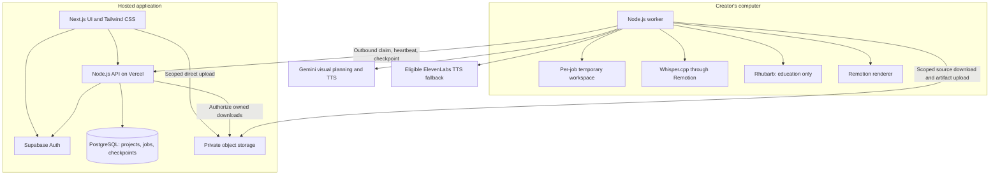
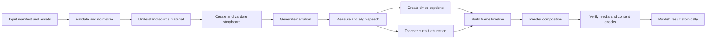

> Authentication revision approved on 24 October 2026: public email/password registration and Google sign-in; no invitations, SMTP, verification emails or password-reset emails in V1. Other product requirements remain unchanged.

> Current authentication requirements are in [PRD](PRD.md), [API design](API-DESIGN.md) and [database design](DATABASE-DESIGN.md). Older invitation/SMTP references below are historical and do not apply to V1.

> Historical prototype document. As of 24 October 2026, accepted education/software samples inform the [full system architecture](SYSTEM-ARCHITECTURE.md). Use that document for current application design and the [tracker](PROJECT-TRACKER.md) for current status; older planned/next-task statements below record the prototype phase.

> Implementation order update (23 October 2026): the first prototype is now EDUCATION, using a topic and audience level. Software and branding follow later. See [local setup](LOCAL-SETUP.md). Technical architecture and three-mode V1 scope remain applicable.

# Initial system and video-pipeline architecture

**Read first:** [How we will build the application](START-HERE.md) explains this design and the prototype plan together, using an example and a local-versus-cloud storage comparison. This document is the detailed engineering reference.

**Version:** 0.1  
**Date:** 23 October 2026  
**Scope:** Whole-system outline and pipeline design for the first feasibility prototype.  
**Product baseline:** [Approved PRD v1.0](PRD.md)  
**Implementation plan:** [Pipeline prototype plan](PIPELINE-PROTOTYPE-PLAN.md)

This document translates the approved requirements into component boundaries, data contracts, and processing behavior. It is not the final application architecture and does not claim that providers, rendering, or native dependencies have already been tested. Prototype findings will inform the detailed database, API, authentication, and deployment design.

## 1. Design decisions

1. Write application and orchestration code in TypeScript. Use Next.js/React and Tailwind CSS for the eventual web app; use Node.js for its backend and the local worker.
2. Use no Python, including captioning, teacher lip sync, and installation scripts authored for this project. Non-Python native media dependencies are allowed.
3. Host the eventual web app and lightweight API on Vercel Hobby. Keep compute-intensive work on the creator's computer.
4. Use Supabase PostgreSQL for metadata and durable jobs, Supabase Auth for users, and private Supabase Storage for media. No R2 integration.
5. Use Gemini for visual understanding and planning; Gemini TTS for speech, with eligible ElevenLabs free API access as fallback.
6. Use Remotion's Whisper.cpp integration for local transcription/timing, Remotion caption utilities, Rhubarb for educational mouth cues, and Remotion for rendering.
7. Store editable scene data and source references independently of the output MP4. Do not generate or execute arbitrary model-written animation code.
8. No background music, paid fallback, voice cloning, or cinematic video generation.
9. Start with a local command-line prototype. It must exercise the real pipeline without requiring a finished website or production database.

## 2. Whole-system outline



The local worker needs internet access for cloud AI and, later, storage/job synchronization. It does not need an internet-facing listening port. If the computer is off, the website can remain available while generation waits.

### Component responsibilities

| Component | Owns | Must not do |
|---|---|---|
| Web UI | Input collection, source previews, user preferences, progress, result playback | Hold provider secrets or claim uncompleted stages succeeded |
| API | Authentication, ownership, job creation, quota reservations, worker coordination, signed access | Render videos or keep a long-running job inside a web request |
| Database | Durable project/revision/job records and state transitions | Store binary videos or base64 media |
| Object storage | Private images, audio, captions, thumbnails, MP4s | Serve permanent public URLs for private user assets |
| Worker | Execute stages, save checkpoints, invoke native tools, render and verify | Bypass deletion/cancellation or execute LLM instructions as code |
| AI adapters | Convert provider requests/responses into our own contracts | Expose provider-specific objects throughout the application |
| Composition library | Render supported layouts from validated scene data | Invent product facts or depend on provider credentials |

## 3. First prototype boundary

The first vertical slice is a **60-second software showcase using three or four screenshots and a description**, rendered in landscape. Its next run must render the same supported content in portrait with appropriate layout changes. All three modes remain V1 requirements.

Input is a local manifest and supplied files. Output is an inspectable run directory containing a plan, generated audio, timed captions, a timeline, a playable MP4, and a report. The CLI is a temporary entry point, not a replacement for the planned web flow.

Do not introduce live auth, email, database migrations, hosted queues, or deployment to prove this slice. Instead, define repository/storage interfaces with local filesystem implementations, so orchestration can later use cloud-backed implementations.

## 4. Pipeline and artifacts



The UI groups these operations into the PRD's four stages: understand content; create story; create voice/captions; animate/prepare video. A technical stage may repeat during bounded repair, but the job must preserve an accurate event history.

| Internal stage | Input | Output | Important check |
|---|---|---|---|
| Validate | Manifest and uploaded files | Normalized assets and hashes | Supported bytes/codecs, bounds, safe paths, required content |
| Understand | Images/selected recording frames and brief | Source inventory with visible facts, uncertainties, regions | Every source ID resolves; embedded text is untrusted data |
| Plan | Inventory, audience, duration, mode | Versioned storyboard | Supported layouts, grounded claims, no absent assets |
| Narrate | Valid scene scripts and voice settings | Audio per scene plus actual provider metadata | Audio decodes, is not silent/truncated, and matches expected speech |
| Align | Clean narration and script | Word/segment timings and transcript comparison | Monotonic bounded intervals and material mismatches identified |
| Caption | Alignment result | Caption groups, SRT and VTT | Readable text and valid scene offsets |
| Mouth cues | Educational narration | Timed mouth-shape sequence | Only valid shapes, no cue beyond audio, rest during silence |
| Timeline | Measured audio, plan, captions/cues | Frame-based render manifest | Duration, offsets, transitions and layout constraints |
| Render | Manifest and resolved local assets | Clean video and requested captioned export | Assets ready, controlled concurrency, complete encoding |
| Verify/publish | Rendered output and all artifacts | Result manifest and report | Correct duration/orientation, audio, file integrity; no cancelled result |

### 4.1 Understanding and planning

Give each asset a stable opaque ID. Prompt the model with these IDs and ask it to map scenes to actual source material. Treat model-proposed highlight boxes as candidates: clamp/check coordinates and reject boxes that leave the image.

For software screenshots, a feature may be visible or supplied by the user. Store which source supports a claim; never imply a static screenshot proves a working interaction. The planner chooses a narrative order rather than assuming filename order is correct. A semantic review checks the script against the inventory, but does not guarantee truth.

The planner emits JSON validated by a runtime schema. Initial layouts: title, screenshot focus, feature cards, recap, and closing. Add product hero and teacher/diagram components during subsequent mode validation. Do not silently substitute an unsupported diagram with an inaccurate graphic.

### 4.2 Speech, providers, and voice consistency

Select actual model/voice IDs from verified account availability at implementation time. Keep them configurable; a model appearing in documentation is not proof that the user's free account can access it.

Use the same provider, voice and delivery settings across a revision. Preview samples are cached. Generate scene narration independently, then measure real durations. Avoid a separate provider request for each individual caption.

Provider failure policy:

- Confirmed Gemini quota exhaustion: attempt eligible configured ElevenLabs fallback without repeated Gemini requests.
- Retryable network/service failure: bounded retry first, then eligible fallback.
- Unsupported request, safety refusal, invalid credentials, or configuration errors: diagnose or stop; do not use fallback to bypass the failure's meaning.
- Both providers unavailable, insufficient free credits, or use rights incompatible: preserve work and wait/fail visibly. Never buy credits.
- Mid-revision provider switch: regenerate all narration for a consistent voice and invalidate its alignment, cues, timeline, and renders. Old completed versions remain separate.

Male/female voice selection will use auditioned prebuilt voices. Sri Lankan English is a preference to investigate, not an established supported accent or a promised V1 capability. The user should judge test samples before an accent label is shown. Accent prompting alone must not be presented as guaranteed regional support.

### 4.3 Caption and teacher timing

Use the provider's returned speech timing when available and valid (for example, an eligible ElevenLabs speech-with-timing response). Otherwise transcribe the actual generated audio locally through Remotion's Whisper.cpp integration. Normalize either output into the same timing contract.

The original script helps detect recognition errors, but must not overwrite a materially different spoken sentence while retaining misleading timestamps. Handle punctuation, numbers, abbreviations and product names explicitly. Reject incomplete or impossible timing data; only use scene-level caption fallback if it still meets the acceptance criteria and is visibly reported in the technical report.

Run transcription and lip-sync analysis on narration alone. Caption boundaries do not determine phonemes or mouth shapes. For education, Rhubarb supplies mouth cues; Remotion renders those cues on the shared timeline. No Python workflow is allowed.

### 4.4 Timing and duration rules

- Use integer frame coordinates for final composition, at 30 fps. Preserve original audio timing in seconds for analysis.
- For a scene, allocate at least `ceil(audioDurationSeconds * fps)` frames plus explicitly planned silence. Never truncate the last word to fit a guessed scene length.
- Determine each scene's start from the cumulative frame durations. Convert its local captions/cues to global time using that scene's actual frame offset.
- Use sequential narration without overlapping voices. Visual transitions must not independently alter the global audio schedule.
- Target tolerance is ±3 seconds, always bounded by 60–90 seconds. A 60-second request therefore accepts 60–63 seconds; a 90-second request accepts 87–90 seconds.
- If narration is too long, rewrite selected scenes within the shared repair budget, then regenerate affected timing. If too short, improve the explanation or add meaningful visual pauses, not an extended blank ending.
- A new aspect ratio reuses valid speech/timing but recomputes visual layout and export. Never stretch a landscape screenshot to fill portrait.

## 5. Logical TypeScript contracts

These illustrate the application-owned boundaries, not finished runtime schemas. Each will need strict runtime validation and bounded values in implementation.

```ts
type Mode = 'branding' | 'software' | 'education';
type Format = 'landscape' | 'portrait';
type VoiceProvider = 'gemini' | 'elevenlabs';

interface GenerationInput {
  schemaVersion: 1;
  revisionId: string;
  mode: Mode;
  title: string;
  brief: string;
  audience?: string;
  targetSeconds: 60 | 75 | 90;
  format: Format;
  sourceAssetIds: string[];
  voiceProfileId: string;
}

interface ScenePlan {
  id: string;
  layoutId: string; // allowlisted; becomes a discriminated union
  narration: string;
  onScreenText: string[];
  sourceAssetIds: string[];
  claims: Array<{ text: string; sourceIds: string[] }>;
  layoutParameters: Record<string, unknown>; // strict per-layout schema
}

interface TimedWord {
  text: string;
  startSeconds: number; // scene-local
  endSeconds: number;
}

interface NarrationAsset {
  sceneId: string;
  assetId: string;
  provider: VoiceProvider;
  modelId: string;
  voiceId: string;
  scriptHash: string;
  durationSeconds: number;
  words?: TimedWord[];
}

interface TimelineScene {
  sceneId: string;
  startFrame: number;
  durationFrames: number;
  narrationAssetId: string;
  captionAssetId: string;
  mouthCueAssetId?: string;
}
```

Separate provider adapters (`VisualPlanner`, `Narrator`), local processors (`CaptionTiming`, `MouthCueGenerator`, `VideoRenderer`), and persistence ports (`ArtifactStore`, `JobRepository`). Initially `ArtifactStore` and `JobRepository` use local files. The cloud implementations must preserve these semantics rather than force a rewrite of the pipeline.

## 6. Durability, idempotency, and recovery

### Local prototype

Store an immutable input snapshot and a run manifest. After each successful stage, validate its output, write artifacts to temporary names, then atomically publish the checkpoint. A crash must not make a partially written JSON file look like a finished stage.

Key reusable results by input hashes, prompt/schema version, provider/model/voice settings, and processor/composition version. Track provider attempts separately from successful checkpoints. On restart, verify hashes and files before reusing them.

### Hosted application boundary

Later job creation will transactionally reserve quota and insert a unique idempotency key. A worker claims a job using an expiring lease and increasing claim token. Heartbeats renew that lease; every checkpoint/finalization is conditional on the current token. A stale worker cannot publish over a newer worker or a cancelled/deleted job.

External requests may consume quota before a timeout is observed. Reconcile status by provider request ID when supported; otherwise record an ambiguous attempt and use the bounded retry policy. Local exactly-once job creation is not a guarantee of exactly-once provider execution.

### Invalidations

| Changed input | Reuse | Recompute |
|---|---|---|
| Only format | Source inventory, script, consistent audio/timing | Layout, render, verification |
| Voice/provider | Source inventory and valid storyboard | All audio, captions, mouth cues, timeline, render |
| One scene's narration | Unchanged source facts and other valid same-voice audio | Changed scene speech/timing and all downstream global offsets/render |
| Screenshot or factual brief | Unchanged files only; other stage reuse requires source-dependency proof | Affected understanding, plan and dependent media |
| Caption styling | Speech and timing | Caption visual layout and captioned render |

Cap repair at two content repair passes and retry transient external stages at most twice, within the PRD's overall job budget. Persist the failure class and safe next action. Cancellation prevents further calls and publication; delete supersedes completion.

## 7. Storage and result contract

Prototype output layout:

```text
local-runs/<run-id>/
  input.json
  manifest.json
  events.ndjson
  sources/
  understanding.json
  storyboard.json
  narration/
  alignment/
  captions/
  mouth-cues/          # education only
  timeline.json
  output/clean.mp4
  output/captioned.mp4 # explicit request/test
  output/captions.srt
  output/captions.vtt
  report.json
```

These paths are proposed artifacts, not files that already exist. Exclude inputs, generated media, caches, credentials and local run logs from Git. Keep only synthetic fixtures permitted for distribution in the repository.

The eventual cloud result stores object keys and checksums, not permanent signed URLs. The API authorizes and issues short-lived URLs. Use private owner/revision-specific keys. Revalidate ownership for URL renewal.

Ready requires successful verification plus durable artifact publication. Clean preview uses a separate caption track; caption-burned output is generated only when requested and must fit quota. Never suggest burned-in captions can be toggled off.

Retain media for seven days under the PRD rules; metadata persists until deletion. Shared asset references and active leases protect required media. Reserve storage for in-progress jobs and export variants. No unrequested eviction at the three-output limit. Signed URL lifetimes must not extend beyond asset expiry; cleanup backlog is distinct from access expiry.

## 8. Security boundaries

- Browser: no AI keys, worker credentials or privileged Supabase keys.
- User API: validate session, ownership, schema, idempotency, storage budget and allowed state.
- Worker: use a dedicated credential and claim-scoped access, not a user's browser session. Revoke/rotate credentials and avoid logging them.
- Local files: resolve paths beneath the assigned workspace, reject traversal/symlinks where needed, and do not recursively delete unchecked paths.
- Native tools: controlled executable paths and argument arrays; no shell interpolation of scripts, filenames or model text.
- Rendering: resolve only validated local assets; disallow LLM-selected remote network URLs and executable code.
- AI: uploaded text is untrusted data. Claims, citations and asset IDs are validated against supplied material.
- Free services: reject paid routes; model availability and usage rights are checked before enabling fallback.

## 9. Quality checks and measurement

Before publishing, inspect video dimensions, codec, stream availability, duration and successful decoding. Validate captions/cues against audio and check representative frames at scene starts, middles and transitions. Detect obvious missing images, text overflow and blank frames using deterministic layout checks plus inspection. Do not claim automatic checks prove educational correctness.

Capture per-stage duration, provider attempts, fallback reason, audio duration, output byte size, peak memory where measurable, source-to-scene mapping, caption timing errors, and render failures. Audio/visual review is a development acceptance task; it is not a manual approval step imposed on each end user.

There is no generation-time SLA until the actual computer and APIs are measured. Tests using mocks must be clearly labeled and cannot establish live voice, caption, or rendering quality.

## 10. What the detailed application architecture will add

After prototype validation, refine:

- Concrete Supabase SQL schema, indexes, transactions, row-level security and storage policies.
- Invite-only registration, session/recovery flow, SMTP delivery and operator privileges.
- Final API request/response schemas, error taxonomy, throttling and worker credential lifecycle.
- Detailed queue leases, concurrency/reservation accounting, cancellation, cleanup and backup operations.
- Next.js route/component structure, design system, player/export implementation and accessibility.
- Deployment configuration, observability, secrets, local-worker installation and restart procedure.
- Confirmed model/voice IDs, dependency versions and measured limits.

Keep the full PRD as the source of product requirements. Record findings and resulting technical changes; do not silently drop education, portrait support, captions, or failure handling to make the prototype appear successful.
