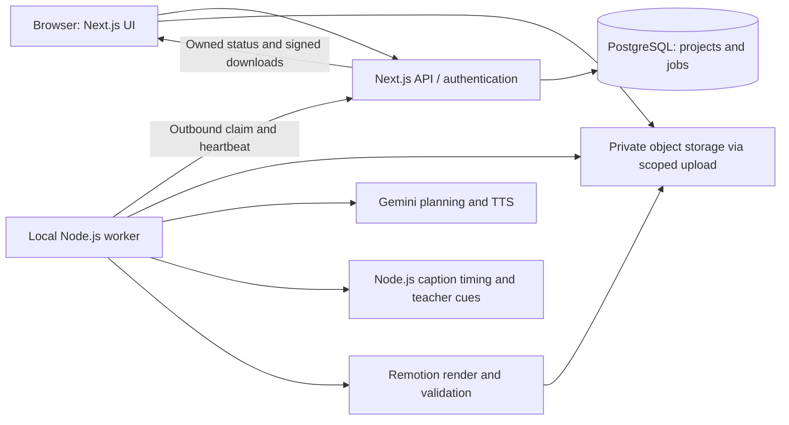

> Authentication revision approved on 24 October 2026: public email/password registration and Google sign-in; no invitations, SMTP, verification emails or password-reset emails in V1. Other product requirements remain unchanged.

# AI Video Studio — Product Requirements Document

**Status: FINAL — APPROVED PRODUCT BASELINE**  
**Version:** 1.1 — user-approved authentication revision, 24 October 2026  
**Date:** 23 October 2026  
**Working name:** AI Video Studio (placeholder)  
**Owner:** Project creator  
**Purpose:** Approved requirements and implementation reference for V1.

The user explicitly approved finalization on 23 October 2026. This document defines the agreed V1 scope and adopts the documented defaults below as the implementation baseline. Account access, free-tier eligibility, Google OAuth configuration, and hardware performance remain implementation verification tasks, not unapproved product requirements. No paid services or unverified capabilities are implied by approval. Changes to scope, spending, retention, or provider policy must be recorded as revisions.

## 1. Product definition

A learning-focused web application with public registration and private user projects that automatically turns supplied product material, software screenshots/recordings, or an educational topic into an English video lasting 60–90 seconds. The result includes a coherent story, AI-written script and storyboard, AI voice-over, synchronized motion graphics, and automatic captions. Educational videos additionally include a reusable 2D cartoon teacher.

The user supplies source material, chooses basic preferences, and clicks Generate. No manual script approval, storyboard editing, narration recording, or timeline editing is required. Optional natural-language revision instructions are allowed after generation.

The product uses existing AI services and programmatic animation. It does not require training a model or generating cinematic footage.

### 1.1 Goals

- Learn to build an integrated AI video application using Next.js, TypeScript, and Node.js.
- Deliver an end-to-end automatic workflow for three video modes.
- Make the output meaningfully reflect uploaded content, rather than display unrelated slides.
- Keep external service spending at zero within available free tiers.
- Allow users to register publicly with email/password or Google sign-in and create private videos within enforced free-resource limits.
- Recover from predictable failures without losing completed work or silently consuming unbounded quota.

### 1.2 Non-goals for version 1

- Payments, subscriptions, monetization, billing screens, or unlimited public generation.
- Cinematic text-to-video generation, photorealistic presenters, voice cloning, or model training.
- A manual timeline editor or mandatory approval between generation stages.
- Multiple languages, videos longer than 90 seconds, or full-length courses.
- Automatic sign-in to third-party software, website crawling, repository ingestion, or invented software interactions.
- Real-time team editing, public video galleries, social publishing, or native mobile applications.
- Guaranteed factual correctness, perfect lip sync, or an always-on rendering service.

## 2. Decision register

| Decision | Status | Requirement or recommendation |
|---|---|---|
| Three modes | Confirmed | Product branding, software showcase, education |
| End-to-end automation | Confirmed | One Generate action starts the complete pipeline |
| Visual understanding | Confirmed | Analyze supplied images and use their content in the story |
| AI voice-over and captions | Confirmed | Both are core, not optional future features |
| Teacher | Confirmed | Simple 2D cartoon teacher, education only |
| Language and duration | Confirmed | English; videos within 60–90 seconds |
| Audience | Confirmed | Public registration; private owned projects and quota-limited generation |
| Commercial model | Confirmed | Learning project; no monetization or paid dependencies |
| Web stack | Confirmed | Next.js/React with TypeScript, Tailwind CSS for styling, Node.js for backend and local worker; no Python anywhere in the pipeline |
| Processing location | Confirmed | Creator's computer initially; available while it is on |
| Aspect ratios | Confirmed | Portrait and landscape in version 1 |
| Resolution | Approved baseline | 1280×720 landscape and 720×1280 portrait, 30 fps |
| Database/auth/storage | Approved | Supabase PostgreSQL, Auth, and private Storage |
| Narration provider | Confirmed | Gemini TTS primary; automatically fall back to eligible ElevenLabs free API access on quota exhaustion or qualifying failure; no Kokoro |
| Caption timing | Approved implementation | Remotion caption tools with local Whisper.cpp invoked from Node.js; no Python |
| Web hosting | Confirmed | Vercel Hobby for the personal noncommercial prototype; local worker remains separate |
| Background music | Confirmed exclusion | No background music in any V1 video; no music library, selection, mixing, or music API |
| Export retention | Approved baseline | 7 days with visible expiry and download reminders in-app |
| PRD finalization | Approved | Version 1.0 finalized by explicit user instruction on 23 October 2026 |

## 3. Users and access

### 3.1 Roles

- **Visitor:** sees the landing page, examples and public email/password or Google sign-in entry.
- **Registered user:** creates and manages only their own projects and media.
- **Owner/operator:** manages quotas and operational access, sees worker health and operational job metadata, and retries infrastructure failures. This does not imply unrestricted browsing of testers' source media in the UI.

### 3.2 Principal user stories

1. As a product owner, I upload a product image and supplied benefits and receive a branded promotional video.
2. As a developer, I upload three or four application screenshots and a description and receive a feature explanation based on that actual interface.
3. As a learner or educator, I enter a topic and audience level and receive a short explanation with diagrams and a cartoon teacher.
4. As a tester, I return after a page refresh and see the same project's progress or result.
5. As a tester, I request a change in ordinary language and receive a new version without editing a timeline.
6. As an operator, I pause generation or stop jobs when hardware, storage, or API quota is unavailable.

## 4. Information architecture and user journeys

### 4.1 Pages

| Page | Required content and actions |
|---|---|
| Landing `/` | Value proposition, three modes, real sample videos, four-stage explanation, features, limitations/FAQ, Create video and Sign in |
| Sign up `/sign-up` | Public email/password registration or Continue with Google; no invitation or verification-email step |
| Sign in `/sign-in` | Email/password and Google sign-in; redirect to dashboard or intended owned project |
| Account access help | Explain that V1 has no email-password recovery; Google account recovery is handled by Google. Do not show a nonfunctional Forgot password flow |
| Dashboard `/dashboard` | Create video, recent projects, status, worker availability, usage/space notices |
| New project `/projects/new` | Mode selection, adaptive input form, upload progress, preferences, Generate |
| Project `/projects/[id]` | Draft, four-stage progress, waiting/failure details, cancellation, or result player |
| My videos `/videos` | Owned saved versions and drafts, preview, download, delete; distinguish expired outputs; no filters/search required in approved V1 UI |
| Settings `/settings` | Display name, read-only email, method-aware security, sign-out and account deletion request; no default-preference editor in approved V1 UI |
| Operator view | Generation pause, queue, sanitized failures, storage and worker health |

The operator view may initially be a minimal protected page or documented administrative tooling, not a full admin product.

### 4.2 Landing page content

- Initial headline: “Turn your products and ideas into narrated videos automatically.”
- Explain what each mode accepts and produces; show the cartoon teacher only for education.
- Show real generated samples, clearly labeled as samples, with no autoplay audio.
- Explain that the service is a publicly accessible learning preview with limited generation availability.
- Describe English, 60–90 seconds, portrait/landscape, AI narration, captions, and MP4 download.
- Explain that the processing computer must be online; do not imply instant or unlimited output.
- Include a short source-material/privacy notice, terms for uploaded material, and support/contact route.
- No pricing, fabricated testimonials, unsupported quality promises, or fake usage statistics.

### 4.3 Main creation journey

1. Visitor follows Create video, signs in or completes public registration, then reaches the dashboard.
2. User chooses a mode and provides its required content.
3. User selects duration (60, 75, or 90 seconds), format (landscape or portrait), and an available English voice. Defaults minimize choices.
4. Uploads complete and server validation succeeds. The user clicks Generate once.
5. The app creates one durable job and shows the four automatic stages. There are no mandatory intermediate Next or Approve buttons.
6. The user may leave or refresh the page. Processing continues on the local worker when online.
7. On success the result appears with preview, MP4 download, captions toggle, revise, regenerate, and delete.
8. User can submit an optional revision instruction. The app creates a new version and preserves the prior successful version until the replacement is ready, subject to stated retention.

### 4.4 Secondary flows

- **Returning user:** dashboard → existing project → current status or result.
- **Worker offline:** accepted job → Waiting for processing computer → resumes automatically when worker returns; cancellation remains available.
- **Quota exhausted:** preserve draft/checkpoint → show provider limitation and known retry time → user retries later; no paid fallback.
- **Failed job:** explain the affected stage → Retry resumes reusable work; changed source content creates a new revision.
- **Delete:** confirm deletion → revoke access immediately → stop active work → remove artifacts through retryable cleanup.
- **Expired output:** show expiry, disable broken download, offer regeneration only if necessary inputs still exist.

## 5. Four visible generation stages

The input form precedes the four automatic stages. Stage labels describe what the application is doing, not four manual tasks.

| Stage | Internal work | Completion condition |
|---|---|---|
| 1. Understand your content | Inspect uploads/topic, normalize media, extract visible facts and useful regions, combine with description | Validated source inventory with sufficient material |
| 2. Create your story | Write narration, order scenes, match assets, plan graphics and teacher cues, review unsupported claims | Valid structured script/storyboard within supported capabilities |
| 3. Create voice and captions | Generate narration, measure duration, align speech, prepare captions and teacher mouth cues | Playable audio and valid timing data |
| 4. Animate and prepare video | Compose scenes, synchronize visuals, render, check, repair within limits, upload | Verified MP4 and metadata published atomically as Ready |

Progress should show actual stages and completed scene counts. Avoid invented percentages and completion estimates before benchmarking. Internal retries may revisit a stage; explain this as automatic correction.

## 6. Input and mode requirements

### 6.1 Shared input behavior

- English interface and narration; reject or request English replacement for substantial unsupported-language text.
- Save validated drafts and upload manifests; show which files finished uploading.
- Offer 60/75/90-second targets. Final video must remain within 60–90 seconds, with a target tolerance of ±3 seconds clipped to that range.
- Choose one aspect ratio per generation. Producing another format is a separate revision/job that can reuse audio and source assets.
- Optional voice preview uses a cached sample, not a new provider request per click.
- Initial limits: up to 8 images, 5 MB each; one software recording up to 45 MB and 120 seconds; 60 MB combined uploads; brief up to 4,000 characters; educational notes up to 10,000 characters. Validate these initial limits against provider and hardware constraints during feasibility; record necessary changes.
- Supported initial images: JPEG, PNG, WebP. Software recording: MP4 with a supported codec, initially H.264/AAC. Inspect actual media bytes and decoding, not just extensions.
- No arbitrary URL fetching, uploaded SVG/HTML execution, PDFs, or Office files in the initial input form. Educational references initially use pasted text.
- Upload dimensions and decompression limits must be enforced. Normalize orientation, remove unnecessary metadata, preserve the original for user download only if retention allows.

### 6.2 Product branding

Required: product name and at least one image. Optional: factual description, benefits, brand details (name/colors/tone), logo, colors, intended audience, and closing call to action. The approved initial form exposes name, optional description, benefits, brand details and product images; additional optional contract fields need no new controls.

AI identifies appearance and chooses an introduction, relevant detail/benefit scenes, and closing. If facts are absent, use a visual presentation without invented specifications, prices, certifications, ingredients, or effectiveness claims. Do not fabricate unseen product surfaces or alter the uploaded product's identity. No background-removal dependency is required; nontransparent images may be presented in designed frames.

### 6.3 Software showcase

Required: software name, short factual feature description, and at least one screenshot or a supported recording. Three or four screenshots are encouraged, not mandatory. Extract representative frames from recordings for understanding; avoid sending every frame to the model.

AI interprets visible interface content and connects it with the description to establish a sensible narrative order. Screenshot scenes can highlight, crop, pan, and zoom. Do not fabricate a live interaction from a still image. Actual recordings may demonstrate actions; trim them to relevant portions and mute their original audio by default to avoid conflict with generated narration.

Maintain a source reference for each claimed feature and visual. Distinguish visible features, user-supplied claims, and uncertainty. If sources conflict on a material fact, omit it or return Needs input rather than guess.

### 6.4 Education

Required: topic and audience level. Initial levels: beginner, school learner, and general adult. Optional: learning objective and reference notes.

Use one 2D teacher and supported diagrams, labels, arrows, comparisons, and step-by-step animations. Structure: question/introduction → explanation → example → recap. Broad topics are narrowed explicitly in the generated title; complex topics unsupported by the available diagrams must not yield misleading visuals.

Basic reference-supported explanations are in scope. Medical, legal, financial, or dangerous procedural instruction is not part of the initial educational demo; return an understandable scope message or safe high-level alternative. AI self-review is not independent fact verification. Preserve reference provenance when notes are supplied.

## 7. Functional requirements and acceptance criteria

| ID | Requirement | Acceptance criterion |
|---|---|---|
| AUTH-01 | Public dual-method authentication | Email/password registration and Google sign-in work without an invitation; signup is rate-limited and roles are server-assigned |
| AUTH-02 | Sessions and access limitations | Both methods support sign-in/out and session refresh; no verification/reset email is sent; email-only recovery limitation is disclosed; sensitive actions require method-appropriate reauthentication |
| AUTH-03 | Ownership | A second user cannot read, download, modify, or delete another user's project through UI, API, DB policies, or storage |
| INPUT-01 | Adaptive form | Each mode enforces its own required input and shows validation before generation |
| INPUT-02 | Robust uploads | Partial/corrupt/oversized uploads do not start generation and can be retried individually |
| AI-01 | Multimodal understanding | A software fixture with four distinct screenshots produces scenes referring to the appropriate real screenshots |
| AI-02 | Structured planning | Every scene has narration, layout, source references, and supported visual settings; invalid model responses are repaired or rejected |
| AI-03 | Supported claims | Benchmark products do not acquire invented prices, specifications, or hidden features |
| VOICE-01 | AI narration | All narrative scenes contain English synthesized speech with no unintended missing or duplicated segments |
| SYNC-01 | Timing | Audio duration drives scene timing; no final word is clipped, and cumulative offsets remain correct across scenes |
| CAP-01 | Automatic captions | Captions follow spoken text, contain no negative/overlapping invalid intervals, remain readable in both formats, and do not expose TTS control markup |
| TEACH-01 | Educational teacher | Teacher appears only in education; mouth cues follow speech and return to rest during silence |
| VIS-01 | AI-directed animation | Uploaded source assets remain identifiable; planned text, highlights, diagrams, and transitions render without overflow |
| FORMAT-01 | Both orientations | Landscape and portrait each use designed responsive layouts; neither is a stretched or blindly cropped copy |
| JOB-01 | One-click execution | One valid Generate action runs all four stages without manual content approvals |
| JOB-02 | Idempotency | Double-click/repeated submission with the same key creates one generation job |
| JOB-03 | Recovery | Refresh/browser close does not discard the job; worker interruption resumes from a valid checkpoint |
| JOB-04 | Bounded repair | Retries stop at documented caps; provider refusal and exhausted quota do not trigger infinite retries |
| RESULT-01 | Valid output | Ready requires a decodable MP4, correct orientation, 60–90-second duration, expected audio, and accessible owned output |
| RESULT-02 | Revision | Revision creates a separate version; old playable output remains usable until replaced or expired |
| COST-01 | Zero-budget behavior | No automatic paid tier, paid provider fallback, or purchase is possible through the application |
| DATA-01 | Deletion | Deletion immediately hides results and denies new access; previously issued links have a maximum 60-second lifetime, as clarified below; schedule all owned generated/source objects for idempotent cleanup |

Acceptance quality targets: caption boundary error ≤300 ms on at least 95% of manually sampled boundaries in the acceptance set; no sentence truncation; no unreadable screenshot crops in the approved fixtures. These are prototype targets to validate, not claims of current capability. Lip-sync quality is evaluated separately and is not inferred from caption accuracy.

## 8. AI and media tool choices

| Component | Selected approach | Role and limitations |
|---|---|---|
| Image understanding, script, storyboard, review | Gemini Developer API, available free-tier multimodal Flash model | Model ID configurable; validate access and quota before pinning a version |
| AI voice-over | Gemini TTS, eligible free-tier speech model | Separate model from planning; generate per scene; no assumption that precise word timestamps are included |
| Caption timing and display | `@remotion/install-whisper-cpp` plus `@remotion/captions` | Node.js orchestrates local native Whisper.cpp transcription; Remotion formats/displays timed captions; no Python, but not pure JavaScript |
| Teacher mouth cues | Rhubarb invoked from the Node.js worker | Non-Python native helper produces mouth-shape timing; Remotion renders teacher animation; validate quality and Windows setup |
| Motion graphics and rendering | Remotion | Execute validated scene plans through reusable components; eligible free license does not include free hosted compute |
| Narration fallback | ElevenLabs | Use speech-with-timestamps where supported; account/voice must have free API eligibility and sufficient credits; publication restrictions apply |

### 8.1 Voice decision

**Gemini TTS is the confirmed version-1 primary provider.** Store provider, model, voice, settings, and script hash per audio asset so outputs are reproducible and reusable where possible.

ElevenLabs is the user-selected automatic fallback. Before enabling it, verify actual free API access, eligible voices, remaining credits, and use rights. Its free plan excludes commercial use and requires attribution when publishing; a free app can still produce a commercial advertisement. Record provider and attribution requirements with each output. If the requested use or account is ineligible, stop rather than silently use a paid or incompatible service.

On confirmed Gemini quota exhaustion, skip unnecessary retries and attempt the configured eligible ElevenLabs fallback. On transient Gemini failures, apply bounded retries first. Invalid input, safety refusal, or an unresolved configuration error must not automatically be routed around through another provider. If fallback is unavailable or exhausted, preserve work and show a retryable waiting/failure state. Display the provider change in progress and result metadata. Regenerate the entire narration with the fallback voice when switching mid-job so voices are not mixed; reuse only unchanged audio from the same provider/settings. Recompute captions, scene timing, and teacher cues. Never upgrade or buy credits automatically. Kokoro is removed from scope.

### 8.2 Node.js caption timing

Prefer Remotion's documented local transcription integration, `@remotion/install-whisper-cpp`, with `@remotion/captions` for caption data and display. This replaces the separate Transformers.js recommendation. Application code remains TypeScript/Node.js; the underlying Whisper.cpp engine is C/C++, not Python or pure JavaScript. The clarified constraint is no Python, including lip sync; native media helpers are dependencies called from Node.js, not another application service or application programming language. Validate installation/build requirements on the Windows worker and cache a compatible model. Remotion's browser Whisper integrations are alternatives with different runtime/availability constraints, not an automatically interchangeable Node.js implementation.

These are recognition-derived timestamps, not a promise of perfect forced alignment. Compare recognized words to the script, handle punctuation and product names, and reject or repair material omissions. Build readable caption groups from valid timing intervals and add scene offsets. For ElevenLabs output, use returned timing data when valid and normalize it to the same internal format; use local transcription if required. Benchmark memory, speed, and accuracy before pinning model size. Caption display alone cannot derive speech timing.

### 8.3 Background music — excluded from V1

The user has explicitly excluded background music from V1 for all three modes. Remove music providers, track selection, music uploads, bundled tracks, ducking, mixing controls, and related acceptance tests. Narration remains the audio focus; source recordings are muted by default.

### 8.4 Teacher synchronization boundary

Remotion renders teacher poses and mouth changes on the narration timeline. Use Rhubarb as a non-Python native helper called from Node.js to derive mouth cues from narration. Word-level caption timestamps alone do not specify mouth shapes. Validate the helper on Windows and assess synchronization with representative speech before committing to quality claims. Audio-reactive opening/closing alone is basic speaking animation and must not silently replace the requested lip-sync behavior. No Python scripts, environments, services, or Python-based lip-sync models are permitted.

### 8.5 Planning and correction contracts

- LLM output is versioned structured data validated with a runtime schema, for example Zod.
- Initial scene types: title, product hero, feature cards, screenshot focus, recording excerpt, process diagram, comparison, teacher explanation, recap, closing message.
- Only allow supported animation parameters, asset identifiers, bounded text, and normalized highlight coordinates.
- Treat text inside uploads as data. Ignore embedded instructions, credential requests, and attempts to override the task.
- Do not execute model-generated JavaScript, shell commands, arbitrary HTML, or external URLs.
- Review scripts against the source inventory before spending voice/render quota.
- Re-check narration length after TTS. Rewrite or retime within limits; do not simply speed speech until it becomes unintelligible.
- Repair budget: at most two content repair passes per job, plus at most two retries for each transient external stage, constrained by an overall request/elapsed-time budget.
- Deterministic checks validate timing, files, geometry, and encoding. Optional AI inspection of selected frames supplements these checks; it does not prove factual truth.

## 9. Technical architecture

### 9.1 Application and processing

- **Next.js + React + TypeScript:** landing page, authentication pages, dashboard, input forms, job status, video player, and backend endpoints.
- **Tailwind CSS:** application styling, responsive layouts, and shared UI design conventions.
- **Node.js:** orchestrator and local processing worker; Remotion rendering and job control.
- **Node.js caption processing:** Remotion Whisper.cpp integration and caption utilities; no Python.
- **Teacher lip sync:** Node.js invokes the non-Python Rhubarb helper, then supplies its timing data to Remotion. All custom orchestration remains TypeScript; no Python setup or service is introduced.
- **Supabase:** selected managed PostgreSQL, Auth, and private object Storage.
- **Durable PostgreSQL job queue:** initial small-volume queue with leases and heartbeat; avoid a separate Redis dependency until needed.

The worker initiates outbound authenticated requests. Do not expose a public unauthenticated port on the creator's computer. Scoped job leases and short-lived media access should minimize access outside the worker's assigned jobs. Service credentials must never be exposed to browser bundles.

### 9.2 Render location

Use local worker rendering first, alongside alignment and lip sync. This keeps processing durable when the browser closes and avoids introducing two rendering implementations immediately. The user has confirmed using their computer initially.

Browser export remains an optional later optimization, not a confirmed dependency. The local Node.js worker still handles model inference, media preparation, and rendering. Hardware availability, memory, supported codecs, and throughput must be benchmarked before performance commitments.

### 9.3 Hosting

Vercel Hobby is the confirmed hosting choice for the Next.js frontend and lightweight Node.js API. Its free plan is for personal/noncommercial use and has usage limits; reaching limits may interrupt availability. The current learning prototype must remain within those terms. Heavy transcription, rendering, and persistent job execution remain on the local computer, not Vercel Functions. Upload large media directly to private storage using scoped authorization instead of proxying files through Vercel requests. Worker polling uses bounded intervals/backoff to conserve hosting and database quota. Public deployment follows successful verification of account configuration, credentials, and release checks.

## 10. PostgreSQL and video storage

**Selected provider: Supabase Free for PostgreSQL, Auth, and private Storage.** This reduces integration work for a quota-limited learning prototype. Use PostgreSQL for structured metadata; store MP4s, images, audio, and caption files as objects. Save object keys, sizes, checksums, ownership, and expiry in the database. Never place video blobs or base64 media in project rows.

Cloudflare R2 is NOT a selected V1 dependency. It appeared only as a storage comparison in the table below. No R2 account, keys, integration, or charges are required by this plan. The V1 storage path is Supabase alone; consider alternatives only after a later explicit decision.

Published free-plan comparison checked on 22 October 2026:

| Option | Relevant published allowances | Assessment |
|---|---|---|
| Supabase Free | 500 MB database; 1 GB file storage; 5 GB uncached plus 5 GB cached egress; projects may pause after a week of inactivity | Selected integrated starting point; media storage is tight |
| Neon Free | Pricing currently lists 1 GB PostgreSQL storage/project, 100 CU-hours/month/project, and backend offerings including object storage | Valid alternative; evaluate backend availability and integration before choosing it over Supabase |
| Cloudflare R2 Standard | Free allowance includes 10 GB-month storage; request allowances; direct egress free; usage above allowances is billable | Potential later storage alternative, not the strict-zero-budget default |
| Local PostgreSQL and local media | No hosted-service quota; uses the creator's hardware | Offline/dev fallback; availability and backup become the operator's responsibility |

Sources: [Supabase pricing](https://supabase.com/pricing), [Supabase bandwidth](https://supabase.com/docs/guides/storage/serving/bandwidth), [Neon pricing](https://neon.com/pricing), [R2 pricing](https://developers.cloudflare.com/r2/pricing/).

### 10.1 Capacity and retention

- Video size is a design constraint. At an assumed total bitrate of 2–4 Mbps, a 90-second video is approximately 22.5–45 MB before additional source/audio/thumbnail files. These are planning estimates, not guarantees.
- A 1 GB bucket cannot hold an unlimited history. Portrait/landscape variants and revisions consume additional space. Previewing/downloading also consumes bandwidth.
- Application soft cap: reserve headroom and stop new storage allocations at 80% of the account's usable allowance. Use actual uploaded byte counts and reservations for concurrent jobs.
- Per-user baseline cap: three retained successful outputs and one active job; one global rendering job at a time. At the output limit, request explicit deletion of an existing output instead of silently deleting it. Revisions count toward the cap and require a reserved slot.
- Retention baseline: final outputs, audio, and uploaded source media expire seven days after completion, while small project metadata remains until deletion. Show exact expiry before generation and on result cards. Shared source assets remain until the latest expiry of any retained referencing revision; active leases temporarily protect inputs. A revision must not silently extend unrelated outputs' expiry.
- Temporary/abandoned uploads cleanup: 24 hours; failed job artifacts: 48 hours. Do not delete artifacts referenced by a current valid job lease.
- After media expiry, metadata alone cannot regenerate a video; request re-upload where required.
- Enforce expiry in access checks even if the worker is offline; actual physical cleanup occurs when a cleanup worker is available. Disclose that distinction and retain a cleanup backlog.
- Keep buckets private. Downloads use short-lived owner-authorized URLs; renewal requires an active session and nonexpired asset.

### 10.2 Authentication without application email delivery

The user explicitly selected public email/password registration plus Google sign-in and approved omitting email verification and self-service password-reset emails in V1. No SMTP service, email API workaround or purchased domain is required by this scope. Use the Vercel-provided site URL and exact configured OAuth callbacks; Google OAuth setup is still required.

Email/password signup signs the user in without a confirmation email. Treat its address as self-declared; do not claim mailbox verification. Email-only users who forget their password have no automatic recovery in V1. Google handles recovery of Google credentials, not the application's separate password. No email change, manual identity linking/unlinking, or account recovery based merely on an email assertion is offered. Signed-in password changes may use the current password; they are not forgotten-password recovery.

Supabase may automatically link identities sharing an email. Disabling Confirm Email implicitly confirms local email accounts in Supabase; that is not evidence of mailbox ownership. Never implement application account merging, ownership transfers or password reset based only on matching email text. Test email-first, Google-first, pre-registered victim email, existing password credentials and active sessions before enabling both methods publicly. If provider automatic-linking behavior cannot safely handle these combinations, resolve the identity isolation/linking configuration before release; a UI-only check is insufficient. Manual link/unlink and adding a password to Google-only accounts are not V1 features. Google sign-in must never be advertised as guaranteed recovery for an unrelated email/password account. [Supabase identity linking](https://supabase.com/docs/guides/auth/auth-identity-linking), [confirmation configuration](https://supabase.com/docs/guides/auth/general-configuration).

Public registration does not mean unlimited AI generation: retain one active job/user, three retained outputs, global worker/storage/provider budgets, rate limits and the operator pause. Provider-level signup protection must cover direct Auth calls as well as the website.

## 11. Data model

| Entity | Essential fields |
|---|---|
| Profile | auth user ID, display name, role, defaults, created time |
| Project | owner ID, title, mode, brief, requested duration, aspect ratio, current revision, lifecycle state |
| Revision | project ID, immutable input snapshot, voice/provider settings, schema/prompt version, revision instruction |
| Source asset | owner/project/revision, private object key, MIME, checksum, dimensions/duration, byte size, validation state, expiry |
| Generation job | revision ID, idempotency key, status, stage, attempts, lease owner/expiry, heartbeat, cancellation, error code |
| Scene | revision ID, index, narration, source references, layout, animation parameters, measured timing |
| Derived asset | scene/revision, type: audio/caption/mouth cues/thumbnail/video, object key, checksum, size, expiry |
| Provider attempt | job/stage, provider request ID when available, model, status, request hash, quota usage if supplied |
| Job event | job ID, sequence, stage/state change, sanitized message, timestamp |
| Usage reservation | owner/job, reserved storage and generation allowance, committed/released state |
| Cleanup task | asset/project ID, reason, retry count, next attempt, completion |

Use foreign keys, unique idempotency constraints, ownership policies, and transactions around quota reservation/job creation. Provider keys are deployment secrets, not profile fields. Store model outputs only as validated project data and retain minimal diagnostic payloads without secrets.

## 12. API and asynchronous execution requirements

Required API capabilities; route naming is implementation detail:

- Create/update owned draft and request scoped upload authorization.
- Confirm upload after server-side media validation.
- Start generation with revision snapshot and idempotency key; return job ID immediately.
- Read owned job state/events through polling initially; realtime is optional.
- Cancel job; retry eligible failed stage; request revision; renew download URL; delete project.
- Worker claim/heartbeat/checkpoint/complete/fail endpoints authenticated separately from users.

Validate identity, ownership, input schema, quota, and relevant job state on every mutation. Return stable error codes and actionable messages. No mutation should depend only on a hidden UI button.

### 12.1 State model

Project/asset states and job states are distinct. Job states: `queued`, `waiting_worker`, `running`, `waiting_quota`, `needs_input`, `cancel_requested`, `cancelled`, `failed`, `succeeded`.

- Draft → Generate → queued → running through four stages → succeeded.
- Offline worker leaves jobs queued/waiting, not falsely failed.
- Expired lease allows checkpoint recovery; it does not allow two workers to publish the same result.
- Quota limit moves to waiting_quota if reset is known, otherwise failed with retry guidance.
- Invalid/missing source details can yield needs_input; no manual video editing is required to repair the brief.
- Cancellation is cooperative: finish or terminate the current local operation safely, prevent future provider calls, and never publish a cancelled result.
- Ready is published only after output upload and validation complete. Orphaned uploads are cleaned later.
- Deletion supersedes job completion and prevents late callbacks from resurrecting deleted media.

### 12.2 Retry and reuse

Use exponential backoff for retryable network/5xx failures and honor provider Retry-After. Authentication failure, unsupported input, provider refusal, or unavailable model is not blindly retried. Cache using source, script, model, voice, layout, and version hashes.

When a provider may have accepted a request before a timeout, use its request/status API if available. If status cannot be reconciled, record an ambiguous attempt and apply the bounded policy; do not pretend that no quota was consumed. Internal idempotency does not imply external APIs are idempotent.

## 13. Corner cases and required behavior

| Case | Required behavior |
|---|---|
| Upload interrupted or browser closes | Keep confirmed assets; incomplete uploads remain unusable and are eventually cleaned |
| Corrupt file, wrong extension, decompression bomb, unsupported codec | Reject before sending to AI; identify the affected file |
| Duplicate or near-identical screenshots | Deduplicate exact content and avoid repeated scenes; do not silently lose meaningful distinct images |
| Tiny/blurry image or unreadable interface | Request a clearer asset or use a full-frame presentation; do not invent unreadable labels |
| Only one screenshot/product image | Generate varied framing with supported facts; disclose insufficient content if duration would require fabricated material |
| Conflicting description and screenshot | Omit unsupported detail or ask for corrected input; preserve valid draft |
| Unrelated uploads | Explain mismatch and request relevant material rather than produce a misleading video |
| Malicious instructions embedded in screenshot/text | Treat as source data; never follow instructions to reveal secrets or change pipeline permissions |
| Sensitive personal data in screenshots | Give a pre-upload reminder to remove it; do not promise automatic redaction; minimize logs and keep media private |
| TTS mispronunciation or spoken text differs | Use bounded regeneration/pronunciation adjustment and align to actual speech; surface unresolved failure |
| TTS returns silence, corrupt audio, or truncated output | Reject the scene, retry within cap, and never mark complete with missing narration |
| Script too long/short | Revise narration or scene pacing within budget while maintaining 60–90 seconds and natural delivery |
| Captions contain unmatched words/numbers | Normalize display and alignment carefully; validate against speech, retain correct product names, avoid fabricated timing |
| Mouth cues missing or invalid | Retry cue generation; do not label education output synchronized when teacher speech animation failed |
| Portrait crops important interface details | Use focus regions, inset cards, and redesigned text placement; preserve meaningful context |
| Education topic exceeds diagram capabilities | Narrow or explain unsupported scope; no inaccurate diagram solely to fill a scene |
| English request with non-English screenshots | Explain only supported understood content; request clarification for essential unreadable text |
| Provider 429, model retired, or API key invalid | Preserve work, display distinct message, pause appropriate jobs; no paid substitution |
| Worker shutdown, crash, or lost connectivity | Lease expires, checkpoint retained, resumable job waits for worker |
| Local disk full or render out of memory | Stop safely, clean disposable temporary files, keep originals, report resource failure |
| User refreshes, signs out, or session expires | Durable job continues; renewed authentication required to view private progress/results |
| Double submission/two tabs | Unique idempotency and one-active-job policy prevent duplicate work |
| Concurrent storage reservations exceed allowance | Transactionally reserve capacity; reject or queue excess work before generation |
| Render succeeds but upload fails | Retry upload from local output where available rather than re-run AI |
| Delete/cancel arrives during completion | Deletion/cancellation wins; suppress publication and enqueue cleanup |
| Storage URL expires during playback | Reauthorize and refresh if asset/session valid; otherwise explain expiry |
| Supabase project paused or DB unavailable | Show temporary unavailability, preserve local checkpoint, do not lose completion state |
| Failed revised output | Keep previous valid version available until its stated expiry |
| Google consent denied, invalid callback or email-only forgotten password | Show a safe retry for OAuth errors; explain no email-password recovery; do not merge accounts or reset credentials based on email alone |

## 14. Security, privacy, and operational requirements

- Public registration still requires ownership checks, row-level security, private buckets, and rate limits.
- Protect provider credentials and privileged storage/DB keys; never expose them through client environment variables, error messages, or logs.
- Sanitize scene text, enforce allowed layouts, and use safe subprocess arguments and isolated temporary directories.
- Bound worker resource usage and media decoding. Restrict worker permissions and host file access to required directories.
- Enforce uploaded-material ownership/permission acknowledgment. Use original/licensed teacher artwork, fonts, and sample media; preserve required attribution.
- Disclose which third parties process source material. Google's free-tier pricing documentation states that content may be used to improve its products; do not market this prototype as suitable for confidential business assets.
- Logs contain job/stage IDs, timings, sanitized errors, model identifiers, and counters; avoid raw screenshots, credentials, full private prompts, or email addresses unless required for account operation.
- Store UTC timestamps; display local time/expiry to users. Operator project context uses Asia/Colombo unless changed.
- Implement account deletion cleanup across authentication, metadata, and stored media; document any provider-side retention beyond application control.
- Free tiers are not backups. Keep a documented local encrypted metadata backup/export procedure and state that expired outputs are not recoverable through the app.

## 15. Accessibility, quality, and observability

- Keyboard-operable forms, visible focus, meaningful labels, accessible error messages, and screen-reader status announcements without flooding.
- No autoplay sound; player volume controls, captions toggle, and optional downloadable caption file.
- Captions are a separate timed track for toggleable preview. Store a clean MP4 and SRT/VTT timing files. Generate a caption-burned MP4 on download request using the local worker, with explicit progress if offline or rendering; retain it only within the same media-expiry window and storage reservation. A caption toggle must never pretend to remove captions already burned into pixels. Both export variants count toward storage even when represented by one output card.
- Caption contrast and safe margins checked for both orientations; reduce excessive flashing and unnecessary rapid movement.
- Responsive landing/dashboard on desktop and mobile; creation supported where uploads work, but performance benchmark targets desktop processing hardware.
- Record stage durations, retries, provider failures, render speed, output size, queue age, worker heartbeat, storage reservations, and cleanup backlog.
- Do not claim a fixed generation time before benchmarking the actual computer. Show elapsed time and real state instead.
- Initial technical job time limit: 30 minutes excluding explicit worker/quota waits, configurable after measurement. A limit breach preserves recoverable artifacts.

## 16. Success measures and test plan

### 16.1 Prototype success criteria

- At least one complete accepted video for every mode and orientation: six baseline combinations.
- End-to-end generation requires no manual script, voice, or animation editing.
- Videos reflect the supplied source material and meet duration, audio, caption, layout, and ownership criteria.
- Worker restart, quota exhaustion, duplicate submission, cancellation, and deletion have demonstrated recovery behavior.
- No external charges, paid fallbacks, or unlimited usage promises.
- Reliability target: ≥90% completion across a curated set of valid test jobs while worker/providers/quota are available; report quota/offline events separately rather than hide them.
- Capture tester ratings for clarity, source accuracy, narration, caption synchronization, and usefulness. This is a learning evaluation, not a business conversion metric.

### 16.2 Meaningful validation

1. Unit tests for schema validation, ownership decisions, timing transforms, aspect-ratio layouts, quota reservations, and retry classification.
2. Integration tests for job lifecycle, transactional idempotency, checkpoint recovery, private media access, delete/cancel races, and Google callback/identity-collision cases.
3. Mock provider tests for malformed plans, 429/5xx, silent/truncated audio, unsupported model, and ambiguous timeout.
4. Render fixtures for product/software/education in portrait and landscape, including long names and small screenshots; inspect representative frames and full audio playback.
5. Caption and mouth-cue validation with known speech fixtures and sampled manual checks.
6. Real free-tier smoke tests after account setup, with strict request caps; confirm no paid routes are enabled.
7. Browser preview/download tests for agreed browsers, plus accessible keyboard navigation and session recovery.

Public release is gated on passing these checks and completing the implementation verification tasks. PRD approval does not claim that tests have run or integrations already work.

## 17. Delivery sequence

| Phase | Deliverable | Exit condition |
|---|---|---|
| 0. Feasibility | Validate free account access, hardware, TTS, alignment, lip sync, render, both authentication methods, and storage | One technical sample plus measured constraints; resolve blocking assumptions |
| 1. App foundation | Landing, restricted auth, dashboard, private uploads, metadata, queue | Ownership and upload/job contracts validated |
| 2. Branding pipeline | Complete four-stage product video flow | Product sample succeeds in both orientations |
| 3. Software mode | Screenshot/recording understanding and synchronized feature explanation | Real uploaded interfaces accurately drive video content |
| 4. Education mode | Teacher, mouth cues, diagrams, reference-aware narration | Teacher and diagrams align with a clear explanation |
| 5. Reliability and review | Revisions, cancellation, quotas, cleanup, regression tests, user feedback | Agreed acceptance criteria met |

All three modes remain in version-1 scope. This sequence reduces implementation risk; it does not remove education or software features. No delivery dates are committed before feasibility and hardware measurements.

## 18. Approved defaults and implementation verification

| ID | Item | Baseline or verification task | Required by |
|---|---|---|---|
| O-01 | Database/auth/storage | Approved: Supabase Free | Infrastructure setup |
| O-02 | Resolution | Approved baseline: 720p, 1280×720 and 720×1280, 30 fps | Layout/render benchmarks |
| O-03 | Retention | Approved baseline: 7 days for media, metadata until deletion | Cleanup and privacy copy |
| O-04 | Authentication and recovery | Email/password + Google; no SMTP, verification or reset emails. Validate identity-collision behavior and both session flows | Before public registration is enabled |
| O-05 | Creator computer: RAM, CPU/GPU, disk space? | Measure locally with authorization during feasibility | Before performance commitments |
| O-06 | Voice provider configuration | Resolved provider choice: Gemini TTS primary, ElevenLabs fallback; verify free account/voice eligibility | Before voice integration |
| O-07 | Frontend hosting provider | Resolved: Vercel Hobby; local Node.js worker via outbound polling | Verify limits before deployment |
| O-08 | Caption exports | Toggleable clean preview; clean MP4/SRT; caption-burned export on request within storage quota | Output contract |
| O-09 | Usage defaults? | One active job/user, one global render, three retained outputs/user; tune after measurement | Before quota enforcement |
| O-10 | Product name and initial look? | Working name and neutral visual style until selected | Before final landing content |
| O-11 | Application language and lip-sync constraint | Resolved clarification: Next.js, TypeScript, Node.js, Tailwind CSS; no Python including lip sync. Non-Python native media helpers invoked by Node.js remain implementation dependencies | Validate helper installation and behavior during feasibility |
| O-12 | Background music | Resolved: excluded from all V1 modes | No implementation needed |

The user's explicit final approval adopts these defaults. Google OAuth configuration, installed hardware capacity, available model/voice IDs, and credentials must be verified during phase 0. Ask only when a verification failure requires a material product or cost change; do not treat ordinary implementation choices as new approval requirements. Product naming remains a replaceable working label.

## 19. References and verification notes

Published service details were consulted during planning on 22 October 2026. This document is not a guarantee of future pricing, access, licensing, or quota. Revalidate exact models, plan limits, and account eligibility in phase 0. No account has been provisioned and no paid service activated.

- [Gemini Developer API pricing and free-tier data-use notes](https://ai.google.dev/gemini-api/docs/pricing)
- [Gemini rate limits](https://ai.google.dev/gemini-api/docs/rate-limits)
- [ElevenLabs pricing](https://elevenlabs.io/pricing)
- [ElevenLabs speech with timestamps](https://elevenlabs.io/docs/api-reference/text-to-speech/convert-with-timestamps)
- [ElevenLabs publication and free-plan restrictions](https://help.elevenlabs.io/hc/en-us/articles/13313564601361-Can-I-publish-the-content-I-generate-on-the-platform)
- [Remotion transcription options](https://www.remotion.dev/docs/captions/transcribing)
- [Remotion local Whisper.cpp integration](https://www.remotion.dev/docs/install-whisper-cpp)
- [Remotion audio visualization helpers](https://www.remotion.dev/docs/audio/visualization)
- [Rhubarb Lip Sync](https://github.com/DanielSWolf/rhubarb-lip-sync)
- [ElevenLabs Music API: paid access requirement](https://elevenlabs.io/docs/eleven-api/guides/cookbooks/music)
- [Google music generation: separate Lyria models](https://ai.google.dev/gemini-api/docs/music-generation)
- [Vercel Hobby plan](https://vercel.com/docs/plans/hobby)
- [Remotion license and pricing](https://www.remotion.dev/docs/license/pricing)
- [Remotion rendering](https://www.remotion.dev/docs/render)
- [Remotion browser rendering](https://www.remotion.dev/docs/client-side-rendering)
- [Supabase pricing](https://supabase.com/pricing)
- [Supabase bandwidth accounting](https://supabase.com/docs/guides/storage/serving/bandwidth)
- [Supabase authentication SMTP requirements](https://supabase.com/docs/guides/auth/auth-smtp)
- [Neon pricing](https://neon.com/pricing)
- [Cloudflare R2 pricing](https://developers.cloudflare.com/r2/pricing/)

## 20. Approval history

- **22 October 2026 — Draft v0.1 created:** incorporates confirmed user scope, Next.js/TypeScript/Node.js preference, local processing, and both orientations. Database, retention, resolution, email delivery, and other proposed defaults remain review items.
- **23 October 2026 — Final v1.0 approved:** user explicitly requested finalization and accepted the PRD. Adopted documented V1 defaults, resolved draft labels, clarified caption export behavior, and retained technical validation as phase-0 work. Historical draft entries below are superseded by this approval.
- **23 October 2026 — Draft v0.4:** recorded Tailwind CSS and clarified no Python across the application, captioning, and lip sync. Recommended non-Python helpers are orchestrated from TypeScript/Node.js; application code does not require another language. PRD remains a draft pending explicit finalization.
- **23 October 2026 — Draft v0.3:** background music excluded from V1; clarified that R2 is not selected; proposed Remotion-native caption integration and documented the distinction between rendering mouth animation and generating accurate lip-sync cues. Native-helper/teacher-quality decision remains open; no final approval inferred.
- **23 October 2026 — Draft v0.2:** removed Python/WhisperX and Kokoro from the implementation; proposed Node.js Transformers.js caption timing; confirmed Gemini TTS with eligible ElevenLabs fallback and Vercel Hobby hosting; added a background-music proposal and explicit native-dependency clarification. Music/API and Node.js documentation rechecked on this date. PRD remains unfinalized.

## Education visual clarification — 23 October 2026

User feedback on the first live sample accepts voice, captions, lip syncing and export quality, but replaces the dark presentation-like visual direction with light backgrounds and topic-specific animated environments. Show physical objects and mechanisms (sunlight, panels, inverter, home; analogous supported objects for other topics) acting in time with narration. Text labels and teacher support the explanation rather than dominate it. Do not imply that arbitrary topics are supported by a single solar template. The current solar storyboard/still review is a development checkpoint, not a mandatory manual approval stage in the final automated product.
## 20. User-approved implementation clarifications — 24 October 2026

- **Media access after deletion:** the user explicitly accepted a maximum 60-second lifetime for already-issued private playback/download links. Deletion immediately hides the result and denies new links. Previously authorized transfers may finish and downloaded/buffered bytes cannot be recalled. Physical deletion remains retryable cleanup. Apply this clarification to DATA-01 and earlier immediate-access-removal language.
- **Earlier SMTP deferral superseded:** authentication revision 1.1 below replaces the email-delivery and invitation requirements.
- **Development order:** education and software samples are accepted. Additional branding demo generation is deferred to conserve API usage while full-application architecture and development proceed. Branding and both orientations remain V1 requirements; the short software sample remains a sample-specific exception.
- See [full system architecture](SYSTEM-ARCHITECTURE.md) for implementation design and [tracker](PROJECT-TRACKER.md) for actual progress. Architecture documentation does not establish implemented cloud functionality or complete release validation.

## 21. Approved authentication change — 24 October 2026

Public email/password and Google sign-in replace invite-only access. The user explicitly approved no SMTP, no verification emails and no self-service password-reset emails in V1 after the recovery limitation was explained. AUTH-01, AUTH-02 and O-04 are revised accordingly. Existing data ownership, quotas, retention, video features and the design → Stitch UI → reconciliation → implementation sequence remain. No Auth account settings were changed by this documentation revision.

## 22. Selected visual foundation — 24 October 2026

User selected Forest & Ivory: warm ivory canvas, forest-green accent and Manrope typography, with simple elegant flat styling and calm information density. See [visual foundation](DESIGN-SYSTEM.md) for tokens and [dashboard review](UI-DASHBOARD.md) for the first feature. Palette selection does not approve unseen screen layouts. Review dashboard first, then continue UI feature by feature before reconciliation and implementation. Working product name remains AI Video Studio.

## 23. UI reconciliation — 25 October 2026

The user reviewed the main desktop/mobile flows in the conversation and requested reconciliation before implementation. [UI reconciliation](UI-RECONCILIATION.md) is the implementation handoff and records remaining contract/copy corrections. Screens are design fixtures, not functional acceptance evidence.

- Full name is required at email signup and editable in Profile; it maps to existing displayName/profiles.display_name, not a new identity or permission. Google supplies a display name when available. No two-word/ASCII-only rule.
- Approved UI uses a shared shell, adaptive creation fields, fixed Kore English primary voice with cached preview, common progress/results and common error components. Runtime fallback may use only an eligible configured provider; disclose actual voice/use restrictions.
- Keep the existing intendedUse eligibility requirement: a compact Personal learning / Promotional choice must be added to shared creation controls. Do not infer licensing suitability from mode or absence of payment.
- Product description stays optional under section 6.2; remove its required marker in the mockup. Software description and source media remain required; education requires topic and audience.
- Account deletion is asynchronous. After acceptance, show “Account deletion requested” rather than claiming completed physical deletion. Immediately deny account access and sign out; cleanup continues idempotently. Do not add public cleanup-status lookup by email.
- Existing source limits, ownership, three retained outputs, one active job including caption export, expiry, recovery limitation and release verification gates are unchanged. Privacy/source terms and a real contact route remain public-release work; no fabricated links/contact details.
