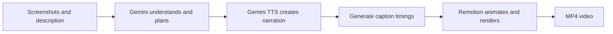

> Current implementation update (26 October 2026): the web scaffold is complete. Use [Project tracker](PROJECT-TRACKER.md) for the next feature, [Web development](WEB-DEVELOPMENT.md) for web setup and [Document map](README.md) for current versus historical references. The older design-first next steps below are historical.

> Authentication revision approved on 24 October 2026: public email/password registration and Google sign-in; no invitations, SMTP, verification emails or password-reset emails in V1. Other product requirements remain unchanged.

> Current authentication requirements are in [PRD](PRD.md), [API design](API-DESIGN.md) and [database design](DATABASE-DESIGN.md). Older invitation/SMTP references below are historical and do not apply to V1.

> Detailed-design update (24 October 2026): system architecture is user-approved. Read [Database design](DATABASE-DESIGN.md) and [API design](API-DESIGN.md) as separate review documents. Next comes Google Stitch UI and design reconciliation before coding.

> Current guide update (24 October 2026): education and software samples are accepted. Read [System architecture](SYSTEM-ARCHITECTURE.md) for the complete application design, database, API and worker behavior. The guide below explains the original prototype approach; its historical next steps are superseded by the [tracker](PROJECT-TRACKER.md). Branding validation remains deferred, not removed.

> Implementation order update (23 October 2026): the first prototype is now EDUCATION, using a topic and audience level. Software and branding follow later. See [local setup](LOCAL-SETUP.md). Technical architecture and three-mode V1 scope remain applicable.

# How we will build the AI video application

**Reading guide for the project owner and developers**  
**Date:** 23 October 2026  
**Current state:** The first local education pipeline has generated a real video. See [prototype findings](PROTOTYPE-FINDINGS.md) and [project tracker](PROJECT-TRACKER.md) for verified results and remaining work.

Start with this document. It explains the system, the prototype, storage, and development order together. The [PRD](PRD.md) remains the approved requirements. The other two documents provide engineering detail when needed; they do not describe two separate applications.

## 1. Why there were two documents

The documents answer different questions:

| Document | Question it answers | Example |
|---|---|---|
| Initial architecture | What are the parts, and how will they work together? | Gemini produces narration; the local worker measures it; Remotion renders scenes to match it. |
| Prototype plan | What should we build and test first? | First generate one software video, then test portrait output and teacher mouth animation. |

Both describe the same project. Separating design from the work plan is useful during development, but it made the initial explanation harder to follow. This guide combines the explanation and order of work. Read the detailed documents only when implementing a particular part.

## 2. What we are building first

We will first build a small program that runs on your computer. You give it an educational topic, audience and optional reference notes, and it produces an actual video.

This is the **pipeline prototype**. A pipeline simply means a series of processing steps where one step's output becomes the next step's input. A prototype is an early working version used to test whether our choices work.

The first prototype will have no landing page, login, or dashboard. We will run it from the terminal using a configuration file. Those user-facing pages come after the core generation process is working.

This is not a fake video demo. The successful live test must use actual image understanding, generated narration, caption timing, and rendering. Some failure tests can use simulated API responses, but we will clearly distinguish them from real generation.

## 3. A concrete example

The software example below explains the later screenshot-based mode. The first implemented prototype uses an education topic; see [prototype findings](PROTOTYPE-FINDINGS.md) for the real example and results.

Suppose you built a task-management application. You provide:

- A dashboard screenshot.
- A project creation screenshot.
- A task-board screenshot.
- A reporting screenshot.
- A description: “This application helps teams create projects, organize tasks, and review progress.”
- Preferences: English narration, a selected voice, 60 seconds, landscape.

The program then performs the following work automatically.

### Step 1: Understand the material

The Node.js program checks that the files are valid images. It sends the images and your description to Gemini through its API.

Gemini identifies the visible screens and the relevant information. For example, it may recognize the task-board columns and the reporting charts. It should not invent a feature such as automatic email reminders if your material never mentions it.

**Output:** a structured description of the source material, saved as a JSON file. JSON is simply a text format our program can read reliably.

### Step 2: Write the story and plan the scenes

Gemini creates the narration script and decides what should appear while each part is spoken.

| Scene | Example narration | Planned visual |
|---|---|---|
| Introduction | “Keep your team's projects organized.” | Application title and dashboard |
| Project setup | “Create a project for your next piece of work.” | Project form screenshot |
| Task organization | “Organize tasks across your workflow.” | Task board with a highlighted area |
| Progress | “Review progress from the reporting screen.” | Reporting screenshot with a gentle zoom |
| Closing | A brief recap of the supported features | Closing title |

This table illustrates the structure; it is not the exact final script or an indication that these short sentences alone fill 60 seconds.

The application validates the plan: does every selected image exist, is the layout supported, and is the text suitable for the requested duration? AI instructions are converted into data for our supported animation components. We do not execute arbitrary code returned by the model.

**Output:** the script and storyboard, stored as structured scene data.

### Step 3: Create voice and captions

Gemini TTS turns the script into spoken audio. If it reaches its quota or has a qualifying failure, we try the configured ElevenLabs fallback when free access and usage rights permit it. If neither can be used, the job stops safely and preserves its progress.

After receiving audio, the program measures how long it actually lasts. It obtains speech timestamps from the provider when available, or from local Whisper.cpp transcription through Remotion's Node.js integration.

A caption might contain:

```text
00:12.200 --> 00:15.800
Organize tasks across your workflow.
```

These timestamps tell the video when to display the sentence. They must follow the actual speech rather than an LLM's estimate.

**Output:** audio files and timed caption files. For education, an additional non-Python tool, Rhubarb, creates timed mouth-shape instructions for the cartoon teacher.

### Step 4: Animate and export

Remotion assembles the screenshots, titles, highlights, narration and captions into video frames. It renders those frames into an MP4 file.

For example, if the task-board narration starts at 12 seconds, the corresponding screenshot and caption must be visible then. The program checks the resulting file's duration, dimensions and audio, and we inspect its quality during development.

**Output:** a playable video you can watch and download. No background music is included in V1.



The user will eventually see these as four progress stages after clicking Generate once. Development testing does not introduce manual script approval into the final user workflow.

## 4. Where will the prototype store its data?

**Initially, files on your computer—not Supabase and not a local PostgreSQL database.**

We will use a folder for each generation run. A simplified example is:

```text
local-runs/example-run/
  input.json          Your description and preferences
  sources/            Your screenshots
  storyboard.json     The AI's script and scene plan
  narration/          Generated voice audio
  captions/           Captions and timings
  manifest.json       Which steps have completed
  output/             The finished video
  report.json         Results and failures from this run
```

These are planned files, not outputs already created. They are ordinary filesystem files, not the browser's `localStorage` feature. Video files are too large and unsuitable for treating browser `localStorage` as the project's media store.

Local storage makes the first experiment easier to inspect. If captions are incorrect, we can inspect the caption file directly without first debugging database access, authentication and uploads.

**Local processing does not mean fully offline.** Gemini and ElevenLabs are online APIs. When we use them, selected images/text or narration text is sent to the provider. Local transcription and rendering use your computer.

## 5. How storage changes in the complete application

We will later replace the prototype's local record/file storage with Supabase-backed storage where appropriate.

Supabase provides several different services:

| Service | What it holds or does | Example |
|---|---|---|
| Supabase PostgreSQL | Structured application records | Project owner, title, script, job status, output expiry and file references |
| Supabase Storage | Actual media files | Screenshots, narration audio, MP4 videos and caption files |
| Supabase Auth | User authentication | Sign-up, sign-in and identity/session handling |

**We will not put the MP4 itself into a PostgreSQL row.** A database record might say:

```text
Project: Task application introduction
Owner: User 123
Status: Ready
Video file key: users/123/projects/456/output.mp4
```

The actual video bytes are in a private Storage bucket. The application checks ownership before granting temporary download access. A file key is a reference, not automatically a public URL.

| Item | First prototype | Complete application |
|---|---|---|
| Project description and plan | Local JSON files | PostgreSQL records |
| Job progress | Local manifest and event log | PostgreSQL job/checkpoint records |
| Uploaded screenshots | Local files | Private Supabase Storage, downloaded temporarily by the worker |
| Intermediate processing files | Local run folder | Worker temporary folder; reusable artifacts uploaded as needed |
| Finished videos | Local output folder | Private Supabase Storage |
| Login | Not needed | Supabase Auth |

We will organize the code so generation asks a storage component to “save an artifact” or “save progress.” Initially that component writes local files; later another implementation writes to Supabase. That keeps the video-generation logic reusable. Cloud integration will still require real work and testing; it is not just changing a URL.

## 6. What runs on Vercel, and what runs on your computer?

A **worker** is a background program that processes jobs. In our project it is a Node.js program running on your computer.

| Location | Responsibility |
|---|---|
| Vercel | Next.js pages, lightweight API requests, accepting generation requests and returning status |
| Supabase | Authentication, project/job records and private media storage |
| Your computer | Calling the AI providers, transcription, teacher mouth analysis, Remotion rendering and upload of results |
| Gemini/ElevenLabs | The online AI operations requested by our worker |

The future full application works like this:

1. A tester signs in and uploads screenshots to private storage.
2. The API checks the request and saves a queued job in PostgreSQL.
3. Your worker asks the API for an available job through an outgoing connection.
4. The worker downloads the authorized source files and runs the pipeline.
5. It saves progress and uploads the completed video.
6. The dashboard shows Ready and lets the owner play or download it.

If your computer is off, the website can still be reachable, but generation waits. Closing the browser does not stop an already accepted worker job. We will not run the heavy rendering process inside a normal Vercel web request.

## 7. How we avoid restarting everything after a failure

A **checkpoint** records a completed processing step and the files it produced.

For example, if voice generation succeeded but rendering failed, the program can reuse valid narration and captions instead of calling the voice API again. If you change the voice, that old narration is no longer valid, so captions and timing must be regenerated too.

A **retry** means trying a failed operation again. We limit retries so a broken service does not consume unlimited requests. An **idempotency key** identifies the same submission, allowing the app to avoid creating two jobs when someone double-clicks Generate.

These behaviors are part of the design from the start. The full database-backed implementation comes after the prototype demonstrates the core processing steps.

## 8. The development order

| Phase | What we do | What you can see at the end |
|---|---|---|
| 1. Initial architecture | Explain the main parts and design the pipeline | This guide and the supporting design documents |
| 2. Local pipeline prototype | Build and test screenshot understanding, script generation, voice, captions and rendering | A real software-showcase video and a test report |
| 3. Technical validation | Test portrait output, failures, fallback voices and a short teacher example | Evidence about what works and what needs adjustment |
| 4. Detailed application architecture | Specify actual database tables, APIs, auth, storage rules, queue and deployment | A detailed design based on prototype findings |
| 5. Complete application | Build the UI, integrate Supabase, finish all three modes and their workflows | A usable application for invited testers |
| 6. Release checks and deployment | Test ownership, expiry, quotas, recovery and deployment configuration | Vercel-hosted application connected to your worker |

The initial design and first live education-pipeline example are complete. Further quality/reliability checks and the complete web application remain. The user selected education before software. Education and branding remain in scope even though software is the first test case.

## 9. What remains to be tested

- Whether your free API accounts expose the selected models and voices.
- How clearly the voices pronounce product names and Sri Lankan place names; a Sri Lankan English accent is not yet guaranteed.
- How accurately captions follow the generated speech.
- Whether the non-Python media tools install and run correctly on your computer.
- How much time, disk space and memory a 60–90-second render needs.
- Whether the teacher's mouth cues are convincing enough for the intended explanation.
- How to deliver invitation/password-reset emails within an appropriate free setup before onboarding testers.

The architecture is a plan for these capabilities, not proof they work already. We will document results honestly before committing to the full application design.

## 10. Where to read more

- [PRD](PRD.md): what the complete product must do.
- [Initial architecture](INITIAL-ARCHITECTURE.md): technical component boundaries, processing contracts and failure handling.
- [Prototype plan](PIPELINE-PROTOTYPE-PLAN.md): implementation tasks and acceptance checks for the first working pipeline.

You can use this guide as the main explanation and consult those documents only for more detail. It adds clarity without changing the approved product scope.
