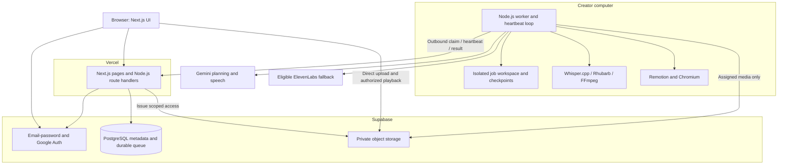
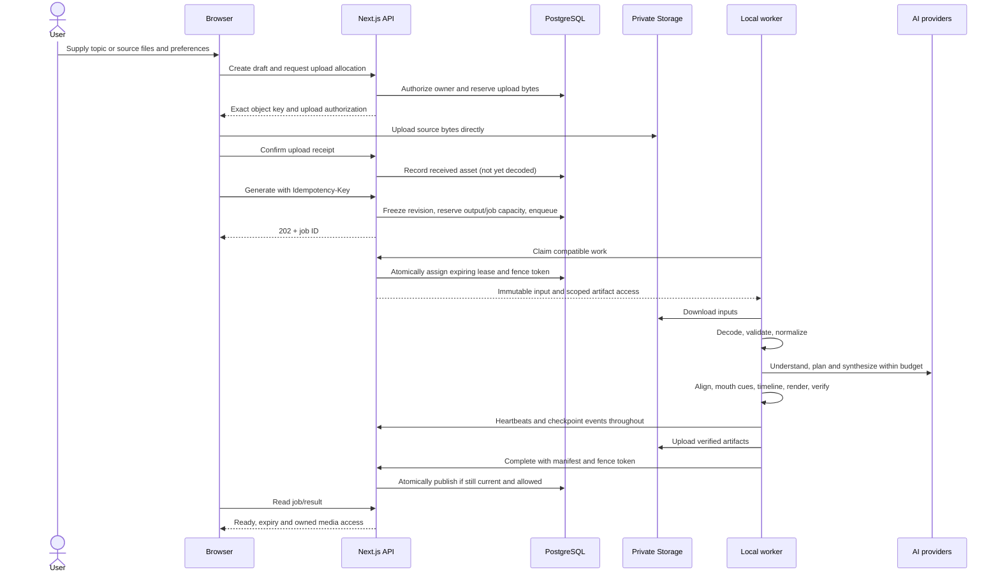
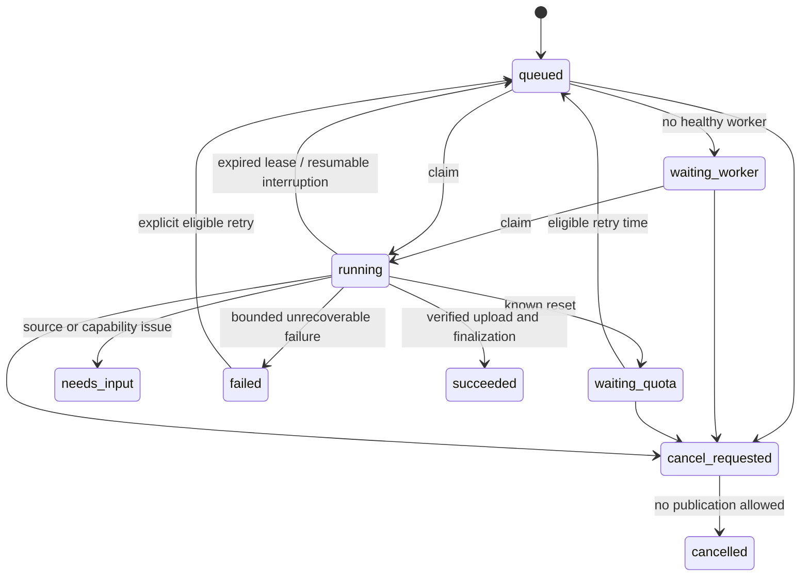
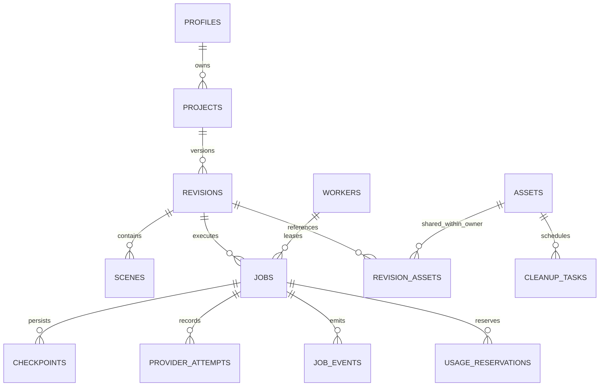

> Authentication revision approved on 24 October 2026: public email/password registration and Google sign-in; no invitations, SMTP, verification emails or password-reset emails in V1. Other product requirements remain unchanged.

# AI Video Studio — system design architecture

**Version:** 1.1 · **Date:** 24 October 2026  
**Status:** Approved by the user; architecture baseline, not a claim of deployed functionality.  
**Product authority:** [Approved PRD](PRD.md). This document supersedes the full-application proposals in [initial architecture](INITIAL-ARCHITECTURE.md), preserving that document as prototype history.  
**Audience:** A software engineer implementing and maintaining this application.

## 1. Read this first

The working local pipeline becomes a background worker behind a web application. Users submit requests through Next.js. PostgreSQL remembers those requests. Your computer claims them, creates the video using the existing pipeline, and uploads the result to private object storage. The browser reads progress and plays the result. Closing the browser does not stop the job; switching off your computer pauses processing availability.

This is one product with two executable applications: a Next.js web application and a Node.js worker. It is not a collection of independently deployed microservices. PostgreSQL is also our durable queue, so Redis and a separate queue service are unnecessary for V1.

### 1.1 Confirmed scope and decisions

| Area | Design baseline |
|---|---|
| Users | Public email/password registration and Google sign-in; each user owns private projects |
| Modes | Education, software showcase, product branding |
| App languages | TypeScript, Next.js/React, Node.js; Tailwind CSS for web styling |
| Native helpers | Whisper.cpp, Rhubarb, FFmpeg/FFprobe and Chromium invoked from Node.js; no Python |
| AI | Gemini planning and primary speech; eligible ElevenLabs speech fallback |
| Hosting | Vercel web/API; creator's Windows computer runs heavy work |
| Persistence | Supabase Auth, PostgreSQL and private Supabase Storage; no R2 |
| Output | English; 60/75/90-second target; 720p landscape or portrait; 30 fps |
| Captions | Clean preview plus VTT; clean MP4/SRT download; burned captions rendered on request |
| Automation | One Generate action, four automatic stages; no required script/storyboard approval |
| Exclusions | Music, cinematic footage, Python, paid upgrades, monetization, public generation |
| Retention | Seven days for successful media; source sharing and active jobs handled explicitly |
| Access-link clarification | User approved a maximum 60-second lifetime for already-issued media links on 24 October; new access stops immediately on deletion |
| Email | No SMTP, verification emails or password-reset emails in V1, explicitly approved by user |

The 35.52-second Make My Marriage video was an explicit sample exception. It does not add short durations to the public V1 form. Branding demo generation is deferred at the user's request to conserve API usage, not removed from scope.

### 1.2 What exists and what we still need

| Existing evidence | Remaining application work |
|---|---|
| User accepted education and software samples | Generic input handling and fully automatic bounded correction |
| Actual Gemini/ElevenLabs narration, captions and teacher cues | Per-scene narration, consistent fallback and timing across scenes |
| Remotion rendering, native tools on Windows, local checkpoints | Durable cloud jobs, leases, ownership, cancellation races |
| Education landscape/portrait demo exports | Every mode and both orientations in the release acceptance set |
| Original solar illustrations and reviewed screenshot crops | Capability registry, automatic region selection, branding/recording support |
| Recorded verification and 18 existing tests | Cloud/API/security/recovery tests and measured quality acceptance |

Some demo scripts and image regions were reviewed manually. Their acceptance proves visual feasibility, not that arbitrary topics or screenshots already work automatically. [Findings](PROTOTYPE-FINDINGS.md), [software sample](SOFTWARE-SHOWCASE.md), and [tracker](PROJECT-TRACKER.md) preserve that distinction.

### 1.3 Reading map

Read sections 2–4 for the whole-system picture; 5–7 for pipeline execution; 8–10 for database, storage and APIs; 11–13 for security and operations; 14–16 for implementation order, acceptance and decisions. Technical defaults below are proposed implementation settings unless explicitly identified as approved product requirements.

## 2. System boundaries and deployment



The arrows from the worker are outbound HTTPS. No inbound port, public tunnel, or browser-to-worker connection is required. APIs return quickly; they never wait for a render or spawn persistent background work inside Vercel.

### 2.1 Responsibility and trust boundaries

| Component | Responsibilities | Credentials/data access |
|---|---|---|
| Browser | Forms, uploads, progress, result player, revisions | User session and public Supabase configuration; no service/provider keys |
| Web API | Session validation, authorization, transactions, limits, worker coordination | Server-only Supabase privileged credential for narrowly controlled operations |
| PostgreSQL | Ownership, immutable revisions, queue, reservations, leases, event ordering | RLS and restricted transactional functions |
| Storage | Images, recordings, speech, captions, thumbnails and video bytes | Private buckets, exact-path upload permissions and expiring reads |
| Worker | Decode, plan, synthesize, align, animate, verify and upload | Provider keys and a revocable worker token; no Supabase service credential |
| AI provider | Receives minimal content needed for the assigned stage | No DB access, host files, tools or executable permissions |

Small JSON travels through the API. Media transfers directly to Storage because Vercel Functions impose payload and runtime limits. This is a design choice to keep expensive work off web requests, not a dependency on one particular function-duration allowance. [Vercel limits](https://vercel.com/docs/functions/limitations).

## 3. Application structure

### 3.1 Proposed repository evolution

```text
apps/
  web/                  Next.js App Router, Tailwind, user/operator UI, route handlers
  worker/               Poller, leases, pipeline orchestration, native subprocess control
packages/
  contracts/            Zod schemas, DTOs, state/error types; browser-safe
  pipeline/             Planning, provider adapters, timing, checkpoint orchestration
  compositions/         Remotion scene registry, teacher, software/product visuals
  persistence/          Server repositories, transactional RPC clients, object-store adapters
supabase/
  migrations/           Reviewed SQL tables, constraints, RLS, functions, indexes
  tests/                Ownership, races, retention and queue integration tests
doc/                    PRD, architecture, tracker, usage and findings
examples/               Nonprivate input examples
local-runs/             Ignored prototype artifacts; preserve existing samples
```

Use npm workspaces. Move working code incrementally with compatibility CLI wrappers; do not reorganize everything before establishing regression checks. Keep all Remotion packages on the same tested version. Pin a supported Next.js/Node combination during foundation setup; do not blindly upgrade the proven media stack.

The web app imports contracts, not FFmpeg, Whisper, Rhubarb or renderer packages. Server-only persistence modules must fail if imported into a client bundle. Package scripts keep web build and worker build separate so Vercel does not download native media dependencies or include local assets.

### 3.2 User pages and behavior

| Route | Responsibility |
|---|---|
| `/` | Three-mode explanation, genuine authorized samples, four-stage workflow, availability/privacy FAQ |
| `/sign-up`, `/sign-in` | Public email/password registration and Google sign-in |
| `/auth/callback`, account access help | Google PKCE callback and clear no-email-password-recovery explanation |
| `/dashboard` | Projects, create action, worker availability and storage/output limits |
| `/projects/new` | Adaptive source form, duration, orientation and configured voice |
| `/projects/[id]` | Draft, stage progress, needs-input/retry/cancel, result and revision history |
| `/videos` | Owned retained results; expiry, download and delete |
| `/settings` | Defaults, sign-out and account deletion request |
| `/operator` | Pause controls, worker/queue/storage/cleanup health; no default tester-media browser |

Server components load authorized initial data; client components handle uploads, polling and playback. Authenticated responses use `Cache-Control: private, no-store`. Do not put private pages or signed URLs in shared caches. Supabase SSR clients manage the browser/server session lifecycle; validate identity server-side on each protected operation. [Supabase SSR](https://supabase.com/docs/guides/auth/server-side/nextjs).

Poll an open active project every 5 seconds, increasing to 15 seconds while waiting; stop when hidden or terminal and refresh on focus. These are tunable defaults. Show real stage, elapsed time and completed scenes, not an invented percentage or ETA. Keyboard focus, upload errors, captions and screen-reader status announcements are part of the feature, not final polish.

## 4. Main user flow and system sequence

The four visible stages follow the input form: **Understand your content → Create your story → Create voice and captions → Animate and prepare video**. They are automatic progress states, not four approval buttons.



Upload receipt is not proof that bytes are safe. API checks existence/size/type metadata before accepting the job; the worker decodes and validates before any AI request. If the worker is off, show Waiting for processing computer. Corrupt uploads lead to Needs input and spend no AI quota.

## 5. Pipeline contracts and execution

### 5.1 Application-owned contracts

These are design interfaces; implement them as strict versioned Zod schemas rather than accepting unchecked JSON.

```ts
type Mode = 'education' | 'software' | 'branding';
type Orientation = 'landscape' | 'portrait';
type Stage = 'understand' | 'story' | 'voice' | 'render';

interface RevisionInput {
  schemaVersion: 1;
  mode: Mode;
  title: string;
  brief: string;
  audience?: 'beginner' | 'school' | 'adult';
  referenceNotes?: string;
  targetSeconds: 60 | 75 | 90;
  orientation: Orientation;
  voiceProfileId: string;
  sourceAssetIds: string[];
  intendedUse: 'personal-learning' | 'promotional';
}

interface ScenePlan {
  id: string;
  ordinal: number;
  narration: string;
  visual: SupportedVisual; // discriminated union, never arbitrary code
  evidence: Array<{
    sourceId: string;
    kind: 'visible' | 'user-supplied' | 'reference-note';
    supportingText?: string;
  }>;
}

interface MeasuredScene {
  sceneId: string;
  startFrame: number;
  durationFrames: number;
  narrationAssetId: string;
  captionsAssetId: string;
  mouthCuesAssetId?: string;
  measuredAudioSeconds: number;
}
```

Every scene's asset IDs must belong to the revision; every layout must be registered for the mode and orientation. Bounding boxes are normalized coordinates inside the source image. Clamp small numeric rounding only; reject materially invalid geometry. All text lengths, scene counts, arrays and numeric ranges have bounds. Education content without references is model-generated explanation, not cited fact verification.

Store `schemaVersion`, prompt version, model/voice configuration, composition version, tool versions and input hashes with artifacts. Old samples keep their old schemas and playback; they are not silently reinterpreted by a newer renderer.

### 5.2 Stage responsibilities

| Stage | Work | Durable outputs and acceptance |
|---|---|---|
| Understand | Decode source files; normalize orientation; choose readable crops/recording frames; Gemini source inventory | Valid asset hashes, dimensions, facts/uncertainties/provenance; no AI on corrupt media |
| Story | Gemini selects supported scenes, narration, source references and motion; semantic checks and bounded repair | Valid structured plan, grounded claims, realistic narration length and supported visual coverage |
| Voice | Speech per scene, actual duration measurement, transcript alignment, readable captions, teacher cues | Decodable audio; measured timing; consistent voice; no unresolved missing narration |
| Render | Global timeline, responsive layout, clean MP4, thumbnail/SRT/VTT, verification and upload | Correct dimensions/30 fps/duration/audio/full decode, durable artifacts, conditional publication |

Automatic correction shares a job budget. Deterministic failures are fixed locally where possible; AI self-review is not an independent factual source. If a required fact or visual is unsupported, return Needs input with a specific explanation rather than silently producing filler slides.

### 5.3 Mode-specific behavior

**Education:** Use a capability registry: topic/mechanism family, allowed objects/actions, layout parameters, evidence requirements and supported orientations. Start from tested hydro/solar components and add reusable processes, comparisons and object diagrams. Prefer light backgrounds, illustrated environments and animation that demonstrates the mechanism. Teacher cues are mandatory. A broad unsupported topic can be narrowed explicitly or rejected with an actionable scope message; no promise of arbitrary nature simulation.

**Software:** Support 1–8 screenshots or one recording. Automatically propose readable crop regions, validate them, and map claims to source images or user text. Preserve the identity of the actual UI. Recording clips use real footage, with source audio muted. Initially sample at most 12 representative frames within the 120-second recording bound; reduce duplicates before provider submission. Do not fabricate clicks, hidden pages or successful signup from a screenshot. The Make My Marriage fixed region map becomes a regression fixture, not the general planner.

**Branding:** Require product name and image; use supplied descriptions/benefits. Animate framing, highlights and typography using original product images. Do not invent unseen sides, technical specifications, prices, certifications or health claims. Transparent images are supported; background removal is not required. Branding remains to be implemented and validated before V1 release.

## 6. Speech, captions, synchronization and exports

### 6.1 Per-scene narration and fallback

Follow the approved PRD's per-scene speech design for the application. The demos used full-track narration; retain their artifacts and CLI behavior. Introducing scene-level speech is a planned migration requiring a focused continuity/timing test, not a claim that it already passed.

Generate 4–6 scenes sequentially with the same provider, voice and delivery settings. Measure each waveform. This permits a narration revision to replace only changed scenes when the voice is unchanged. When switching to ElevenLabs partway through a revision, generate a consistent complete scene set with the fallback voice; do not mix speakers. Record attribution/use restrictions in result metadata. An ineligible promotional request cannot silently use a personal-use fallback.

The prototype's verified configuration is Gemini `gemini-3.5-flash-lite` for planning, `gemini-3.8-flash-tts`/Kore for primary speech, and ElevenLabs `eleven_flash_v2_5`/Alice for fallback. These are historical working configurations, not future availability or quota guarantees. Keep them in a server/worker registry and revalidate account eligibility before enabling live jobs. Sri Lankan English remains an unverified preference; label only auditioned voice capabilities.

### 6.2 Shared clock

Normalize speech for analysis without changing pronunciation or timing silently. Prefer valid provider word/character timestamps, otherwise transcribe actual speech with local Whisper.cpp. Compare normalized recognized text with the script; word coverage detects omissions but does not prove accurate boundaries. Unresolved material mismatches fail the stage. Do not generalize the sample's manually reviewed homophone replacement into arbitrary script-overwrites of recognition.

For education, Rhubarb analyzes each actual speech waveform and emits mouth-shape intervals. Remotion reads those intervals; captions alone do not drive phoneme shapes. Teacher mouth returns to rest during pauses and after speech.

At 30 fps, allocate each scene at least `ceil(audioSeconds * 30)` frames plus explicit visual pauses. Convert scene-local captions and mouth cues using `startFrame / 30`. Voices never overlap; visual transitions do not change audio offsets independently. The final timeline is consecutive and ends after the final spoken word.

Output target ranges are 60–63, 72–78, and 87–90 seconds for requests of 60, 75, and 90 seconds. Rewrite/retime within the repair budget when needed. No truncation or long blank padding to pass duration checks. Natural pauses must support the explanation. The prototype's long final silent recap is not a target for every generated video.

### 6.3 Preview and export

Publish a clean H.264/AAC MP4 and VTT track for toggleable preview; also offer SRT. Use designed portrait layouts, not stretched landscape compositions. Burned captions are a separate `caption_export` job using saved timeline/audio/assets, with no new AI calls. It reserves extra bytes but belongs to the same successful-output card and shares its original expiry.

A second orientation creates another revision/output slot; it reuses compatible source understanding, speech and timing. A clean preview is not generated by pretending burned captions can be switched off. A deleted/expired source or checkpoint may make a later export impossible; explain re-upload requirements rather than unexpectedly purchasing regeneration.

## 7. Durable jobs, concurrency and recovery

### 7.1 Queue design

PostgreSQL is the authoritative queue. The worker keeps an independent heartbeat loop while subprocesses run. V1 permits one globally active processing lease and one active generation/export job per user. Serial processing is deliberately stricter than merely one simultaneous render to fit the observed limited free memory.

Claim work in a short transaction: lock the global worker-slot row, select the oldest eligible job using `FOR UPDATE SKIP LOCKED`, lock that job, check account/project/cancellation/quota/version compatibility, increment its fence counter, set lease owner/expiry, and commit. Never keep a DB transaction open during AI or rendering. PostgreSQL documents `SKIP LOCKED` for queue-like consumers; the complete claim rules here are application design. [PostgreSQL SELECT](https://www.postgresql.org/docs/current/sql-select.html).

Proposed defaults: lease 90 seconds, heartbeat every 20 seconds, offline display after 90 seconds. Idle worker polling backs off from 15 to 60 seconds with jitter; DB/API failure backs off to five minutes. Server time is authoritative. Claim attempts opportunistically reconcile expired leases, so correctness does not require Vercel cron. Cleanup has its own small leased tasks and bounded batches.

Every mutation from a worker carries `{jobId, workerId, leaseToken}`. Database checks current token and unexpired lease, active project/account, allowed state and artifact ownership. A stale worker receives `LEASE_LOST` and stops. No new external call may start without a current lease. If networking fails, terminate/suspend work when the lease can no longer be safely renewed; preserve local files. An already accepted provider request may still incur usage.

### 7.2 Job state transitions



Needs input preserves the failed revision; corrected content creates a new revision/job. Cancelling a nonrunning job can complete immediately. A running cancel sets the flag and invalidates publication in the same transaction; worker safely stops children and acknowledges. Lease expiry reconciles a cancellation even if that worker never returns. Project deletion is a separate lifecycle flag that takes precedence over every state transition.

### 7.3 Idempotency and transactions

`Generate` requires an `Idempotency-Key`. In one transaction: check existing request record; lock account/global quota rows; check expected draft version; validate upload receipt states; freeze input; reserve storage and a result slot; insert revision/job/event; store response. Same key and request hash returns the same job; different body with the same key returns 409. A second tab with a different key still cannot bypass the one-active-job constraint.

Retry keeps the original immutable revision and matching checkpoints. Record a new job attempt without resetting consumed call/repair counters automatically. An exhausted budget requires an explicit new generation, with usage notice; it cannot be refreshed by repeated Retry clicks. Revision creation and export creation use the same idempotency and reservation pattern.

### 7.4 Checkpoints and provider budgets

Checkpoint identity is a hash of source dependencies, input, prompt/schema/tool/composition versions and provider/voice settings. Write artifact bytes, verify hash, upload required durable artifacts, then register the checkpoint. Local atomic files accelerate recovery; cloud manifests make a different workspace capable of resuming. Recheck file existence/hash before reuse. No cross-user cache sharing.

| Change | Reuse | Invalidate |
|---|---|---|
| Orientation only | Plan where layout-compatible; same speech/timings | Layout, render, verify |
| Caption styling / burned export | Speech, transcript, cues, source plan | Requested render variant |
| One narration scene | Unchanged compatible scenes | Changed audio/alignment/cues and all subsequent global offsets |
| Voice/provider/settings | Source inventory and plan | All speech and downstream artifacts |
| Source or factual brief | Unchanged source files | Dependent understanding, plans and affected media |
| Composition version | Compatible content/audio | Layout validation and renders |

Defaults: two total content repair passes per job; initial call plus at most two transient retries per logical external operation; at most 24 external attempts per generation including understanding/planning, speech, repairs and fallback. The overall cap wins even if a particular stage has retries left. This is a ceiling, not an intended number of calls. Persist counters before dispatch. Stop after 30 minutes of active processing, excluding explicit worker/quota waits; persist accumulated active time across restarts.

Known quota exhaustion skips repeated calls to that provider; use eligible fallback or wait. Network/5xx uses jittered backoff and Retry-After within budget. Authentication/model/configuration/refusal errors do not trigger bypass. Unknown quota reset is a visible failure with retry guidance, not a fabricated countdown.

For a timeout after a request might have been accepted, record `outcome_unknown` and provider request ID when available. Reconcile only if the provider supports it; otherwise retry within budget with possible repeated usage acknowledged. Internal exactly-once enqueue does not guarantee exactly-once paid/free-provider consumption. Track observed token/character counts when returned; leave unknown usage null rather than zero.

### 7.5 Atomic publication

Upload into immutable, job-attempt-specific keys. Register expected object IDs/sizes/hashes, confirm storage receipt, then finalize in a transaction that locks job/project/quota records. Check lease fence, cancellation/deletion, duration/format report, all required artifacts and capacity. Set succeeded, result pointer and expiry; commit actual bytes and release unused reservations together.

Storage and PostgreSQL do not share a transaction. A crash between upload and finalization leaves an unpublished orphan, never a Ready result. Retry finalization idempotently or clean it later. The trusted local worker performs full decode/hash checks; the API confirms object metadata and report consistency, not a second full video decode on Vercel. A lost completion response is resolved by reading job state before resubmitting.

## 8. Database design overview

The detailed implementation contract is now in [Database design](DATABASE-DESIGN.md). The following outline explains the architectural entities; use the separate document for complete fields, constraints, state transitions, indexes and migrations.

Use SQL migrations and Supabase clients/RPCs; no ORM is necessary for the initial queue's explicit transactions. All IDs are UUIDs unless stated; times are UTC `timestamptz`; byte counts are nonnegative `bigint`. Store videos in Storage, never bytea/base64 in database rows. Bounded structured inputs/plans use JSONB validated at the API and worker; DB constraints enforce core relations and states.

### 8.1 Logical entity relationships



### 8.2 Tables, key fields and constraints

| Table | Important columns and invariants |
|---|---|
| `profiles` | `id` FK auth user, display_name, defaults JSONB, status active/deleting/disabled; role is server-managed, never self-editable |
| `projects` | owner_id, title, mode, draft_input JSONB, draft_version, latest_ready_revision_id, deleted_at; owner/mode immutable after first generation |
| `revisions` | project_id, owner_id, revision_number, parent_revision_id, immutable input JSONB/hash, instruction, schema/prompt/composition versions, status, completed_at, expires_at; unique(project_id, revision_number) |
| `assets` | owner_id, project_id, creator_job_id, kind, bucket/key, checksum, byte_size, mime, dimensions/duration, state, received_at, expires_at, deleted_at; unique(bucket,key); no user-selected storage paths |
| `revision_assets` | revision_id, asset_id, purpose, scene_id nullable; unique(revision_id,asset_id,purpose); references require same project and owner |
| `scenes` | revision_id, ordinal, source references, validated plan JSONB, start_frame, duration_frames; unique(revision_id,ordinal); content frozen once selected plan checkpoint is published |
| `jobs` | owner_id, project_id, revision_id, kind generation/caption_export, status, stage, available_at, attempt_count, counters, active_ms, worker_id, lease_token bigint, lease_expires_at, cancel_requested_at, safe_error_code |
| `checkpoints` | job_id, stage/scene_key, dependency_hash, manifest JSONB, producer_version, status; unique(job_id,stage,scene_key,dependency_hash); copied references can reuse parent artifacts |
| `provider_attempts` | job_id, operation_key, provider/model/voice, request_hash, status dispatched/succeeded/failed/outcome_unknown, request_id, usage JSONB nullable, elapsed_ms; never raw key or full private prompt |
| `job_events` | job_id, sequence bigint, stage, code, safe_message, created_at; unique(job_id,sequence); sequence allocated transactionally per job |
| `idempotency_requests` | owner_id, operation, key, request_hash, resource_id, response_code; unique(owner_id,operation,key); preserve while associated project/job exists |
| `usage_accounts` | scope global/user, used_bytes, reserved_bytes, retained_outputs, reserved_outputs; locked in fixed order on allocation |
| `usage_reservations` | owner/job/upload_id, byte allowance, output_slots, state reserved/committed/released, expiry; unique allocation identity to prevent double release |
| `workers` | token_hash, label, enabled, protocol_version, capabilities, last_seen_at; no plaintext worker token |
| `worker_slots` | single processing slot, job_id, lease token/expiry; transactional global concurrency guard |
| `cleanup_tasks` | object/asset_id, reason, status, lease, attempts, next_attempt_at; deduplicate pending tasks per object |
| `operator_audit` | actor, action, resource ID, safe metadata, time; privileged operations only, no media contents |

Ownership should be enforced structurally using composite unique keys and foreign keys such as `(project_id, owner_id)`, not only copied owner fields. `latest_ready_revision_id` must reference a revision of that same project. Enforce same-owner parent revisions and asset references. Use checked text enums for state values and legal transitions in transactional functions.

Partial unique index on `jobs(owner_id)` covers queued, waiting_worker, running, waiting_quota and cancel_requested states. Failed, needs_input, cancelled and succeeded release the active-job slot. A separate unique constraint/transaction prevents duplicate successful caption variants. The global worker-slot lock enforces one active processing job even across multiple accidental worker instances.

Indexes: projects(owner_id,updated_at,id); revisions(project_id,revision_number); jobs(status,available_at,created_at) for claimable states; jobs(lease_expires_at) for running; events(job_id,sequence); assets(state,expires_at); revision_assets(asset_id); cleanup(status,next_attempt_at). Cursor pagination avoids unlimited list responses. Confirm indexes with actual query plans after migration.

### 8.3 Authorization and transactional function boundary

Enable RLS on every exposed application table. Anonymous users have no project access. User SELECT policies join active owned project/profile and exclude soft-deleted data. User writes are limited to safe profile defaults and authorized draft operations; jobs, worker state, scene checkpoints, reservations, role changes and asset confirmation cannot be updated directly from the browser.

Use restricted functions for `enqueue_generation`, `claim_job`, `renew_lease`, `save_checkpoint`, `finalize_job`, `cancel_job`, `reserve_upload`, `expire_media` and `soft_delete_project`. Revoke default PUBLIC execution; assign minimum roles. Security-definer functions set a fixed safe search_path, qualify relations, and derive user identity from authenticated context, not client-supplied owner IDs. Worker functions are invoked only by the authenticated worker API with server authority. Privileged credentials bypass RLS, so API authorization remains mandatory and is separately tested.

Do not hard-delete metadata with cascading object loss before cleanup completes. A tombstoned project/account retains enough private operational metadata to finish deletion; afterward purge personal data and auth identity in a retryable sequence.

## 9. Private storage, upload validation and retention

### 9.1 Object layout and upload lifecycle

Private buckets: `source-media` for uploaded originals/normalized assets and `generated-media` for derived artifacts. Deterministic opaque path shape:

```text
<owner-id>/<project-id>/<asset-id>/<opaque-filename>
```

Keys are server allocated; never accept arbitrary caller paths or upsert published files. Worker attempt outputs use distinct asset IDs. Object state proceeds `allocated → received → validated → available → expired/deleting → deleted`; invalid bytes become rejected. User previews use a locally created object URL before upload; unvalidated cloud assets are not exposed as trusted rendered content.

Allocate bytes before upload. The browser uploads directly using its authenticated Supabase session and an INSERT policy requiring an active, unexpired exact-path allocation owned by `auth.uid()`. No browser UPDATE/DELETE policy, and no arbitrary own-prefix uploads. For recordings use resumable TUS with the same authorization; expire abandoned allocations and cleanup upload remnants. [Supabase resumable uploads](https://supabase.com/docs/guides/storage/uploads/resumable-uploads).

Bucket limits enforce broad maximum size/type. API compares storage size with the per-asset reservation; worker inspects signatures, decodes and recomputes hashes. Exact content/type and image dimensions are not trusted from request headers. A malicious client might upload within the bucket maximum but beyond its image allocation; reject it, remove it promptly and reconcile actual usage. Reserve headroom for this case. Storage policies are enforced independently of UI checks. [Supabase Storage access control](https://supabase.com/docs/guides/storage/security/access-control).

Initial PRD limits: eight JPEG/PNG/WebP images ≤5 MB each; one MP4/H.264 recording ≤45 MB and ≤120 seconds; total uploads ≤60 MB; brief ≤4,000 characters and notes ≤10,000. Proposed decode guards: ≤32 million pixels/image, longest edge ≤20,000 pixels (supports the tested tall screenshot), recording ≤3840×2160 and ≤60 fps. Bound frame extraction, decoder memory and subprocess time. No SVG/HTML/PDF execution, URL fetching, website crawling or archives.

### 9.2 Media reads and deletion semantics

API authorizes the active owner, asset state, parent project and expiry, then issues a read URL with lifetime `min(60 seconds, remaining asset lifetime)`. Do not persist signed URLs; store keys. Do not grant browser roles Storage SELECT/signing privileges: otherwise a caller could mint a longer-lived URL directly and bypass this cap. All private media reads are authorized through this endpoint. Refresh on demand and preserve playback position if an expired URL interrupts a range request. VTT renewal must also be handled. Operator metadata access does not automatically authorize user media.

Private Storage signed URLs are bearer capabilities; a policy change alone is not immediate revocation of an issued URL. The user accepted the maximum 60-second link lifetime. Hide deleted results and deny new links immediately; enqueue physical deletion. Already downloaded/buffered bytes cannot be recalled, and a transfer authorized before expiry may finish after expiry. This qualifies the PRD's immediate access-removal language without promising recall. [Supabase downloads](https://supabase.com/docs/guides/storage/serving/downloads).

### 9.3 Capacity and expiration

Enforce the PRD's 80% soft cap against the verified account allowance, one active job/user, three retained successful outputs/user, and one global processor. Configure allowances during setup; do not assume historical advertised free limits equal current remaining capacity. Revisions consume a new output slot; a failed revision keeps the old result. At three retained outputs, ask the user to delete one explicitly before generating another.

Proposed derived-media reservation: 160 MiB/generation in addition to already reserved source bytes; enforce a 50 MiB ceiling per MP4 and bound retained intermediate audio/frames. Tune using measured outputs, not quality-reducing surprise compression. If a result needs more space, atomically extend its reservation before upload or fail capacity safely. Do not count a reused object twice. Burned exports reserve their own bytes without consuming an extra output card.

Quota invariant: actual known stored bytes + outstanding reservation remainder + cleanup/orphan bytes must remain below the configured soft cap. Transfer actual bytes from reservation to usage as objects arrive; never double count the same allocation. Reserve globally and per user in a fixed locking order. Release physical-byte usage only after confirmed object deletion; expired but unremoved objects still occupy space.

Successful revision expiry is completed_at + seven days. Derived variants share that expiry; they do not extend it. Shared source/checkpoint retention follows the latest live referencing revision, while unrelated outputs retain their original expiry. An active valid job temporarily protects required inputs; waiting or failed jobs cannot hold sources indefinitely. Abandoned uploads expire after 24 hours, failed artifacts after 48 hours. A protected artifact becomes eligible again when the lease/reference ends. Expired inputs require re-upload before retry, rather than silently extending retention.

User access checks expire independently of the cleanup worker. Cleanup runs on worker startup and periodically while online in small idempotent batches; unresolved failures back off and appear in operator health. Reconcile DB manifests with actual bucket inventory daily while online to recover orphaned uploads and accounting drift. A DB/storage outage preserves reservations and local results until reconciliation, not optimistic success.

## 10. API design overview

The detailed endpoint/authentication/request/response contract is now in [API design](API-DESIGN.md). The following routes are the architecture outline; the separate document specifies their full behavior and supporting endpoints.

All application routes below use `/api/v1`. JSON bodies are bounded (proposed 64 KiB user control request); large media never crosses these handlers. Validate Zod schemas, session/role, ownership, current state and quota on every mutation. User mutations check same-origin/CSRF protections when using cookies. Pagination defaults to 20, max 100; event requests use `afterSequence` and max 100.

### 10.1 User endpoints

| Method/path | Request or responsibility | Response |
|---|---|---|
| `POST /projects` | mode, title, draft input | 201 project + draftVersion |
| `GET /projects` | cursor, mode/status filter | Owned project page |
| `GET /projects/:id` | Owned detail with revisions/current state | 200 sanitized DTO |
| `PATCH /projects/:id` | expectedDraftVersion, draft changes | Updated draft; 409 on stale edit |
| `POST /projects/:id/uploads` | filename, declared mime/bytes | Exact upload allocation, expiry, protocol |
| `POST /uploads/:id/complete` | Receipt completion; no trusted client hash | received state after storage metadata check |
| `DELETE /uploads/:id` | Remove unused draft asset | 202 cleanup requested |
| `POST /projects/:id/generations` | draftVersion, preferences, Idempotency-Key | 202 jobId, revisionId, statusUrl |
| `GET /jobs/:id` | Current state, stage, counts, safe error, retry time | 200 job DTO |
| `GET /jobs/:id/events` | afterSequence | Ordered event page |
| `POST /jobs/:id/cancel` | Idempotent cancellation | 202/200 state |
| `POST /jobs/:id/retry` | Eligible unchanged revision/checkpoints | 202 resumed job or explicit conflict |
| `POST /projects/:id/revisions` | parentRevisionId, instruction/preference changes, idempotency | 202 new revision/job |
| `POST /revisions/:id/exports` | captionMode=burned, idempotency | Existing variant or 202 export job |
| `POST /assets/:id/access` | preview/download and authorized asset ID | URL and expiresAt; never arbitrary key |
| `DELETE /projects/:id` | Confirmed user intent in UI | 202 tombstoned/cleanup scheduled |
| `DELETE /revisions/:id` | Remove owned output; maintain shared dependencies | 202 tombstoned/cleanup scheduled |
| `GET/PATCH /me/settings` | Display name and allowed defaults; optimistic versioning | Read-only email/auth methods; approved UI edits display name only |
| `POST /me/deletion` | Recent authentication and confirmation | 202 account deletion workflow |
| `GET /availability` | Authenticated worker/provider pause summary | No secrets or internal stack traces |

Public email/password registration, Google sign-in and sessions use Supabase Auth with SSR. There are no invitation, verification-email or password-reset endpoints. Operator endpoints pause/resume generation and inspect operations under server-verified role and audit logging. Method-specific reauthentication protects account deletion; see the detailed API and database contracts.

Example creation response:

```json
{
  "jobId": "<uuid>",
  "revisionId": "<uuid>",
  "status": "queued",
  "stage": "understand",
  "statusUrl": "/api/v1/jobs/<uuid>",
  "reused": false
}
```

Stable error shape:

```json
{
  "error": {
    "code": "STORAGE_CAPACITY",
    "message": "Delete an existing output before generating another video.",
    "retryable": false,
    "requestId": "<opaque-id>"
  }
}
```

Use 400 malformed input, 401 unauthenticated, 403 disallowed role, 404 absent or foreign resource (avoid enumeration), 409 state/version/idempotency conflict, 413 oversized control/upload request, 422 unusable content, 429 application/provider limit, 503 temporary infrastructure failure. Return `retryAt` only when known. Never leak provider response bodies or credentials.

### 10.2 Worker endpoints

Separate `/api/worker/v1`, authenticated with a high-entropy bearer token whose hash is stored server-side. Require TLS and protocol version. Provision/revoke tokens through operator tooling; never put them in public environment variables. Worker token identifies the worker, not a user. Server derives assigned owner/job scope from the lease.

| Endpoint | Semantics |
|---|---|
| `POST /claim` | Capabilities/version, atomic claim; 204 when no work |
| `POST /heartbeat` | Worker health; job lease token if active; returns cancellation/pause controls |
| `POST /jobs/:id/checkpoints` | Validated stage manifest with dependency hashes and current fence |
| `POST /jobs/:id/provider-attempts` | Reserve/persist attempt before outbound provider call; record result idempotently |
| `POST /jobs/:id/artifact-access` | Exact assigned input download or allocated output upload; no arbitrary object list |
| `POST /jobs/:id/artifacts/confirm` | Object metadata receipt and manifest hash |
| `POST /jobs/:id/complete` | Verification report and artifact IDs; atomic conditional publication |
| `POST /jobs/:id/fail` | Sanitized class, retry guidance and budget accounting |
| `POST /jobs/:id/cancel-ack` | Confirm stopped work and relinquish lease |
| `POST /cleanup/claim`, `/cleanup/:id/complete` | Assigned idempotent cleanup operations only |

Worker storage uploads use exact-object signed authorizations with no overwrite. Such credentials may outlive a lease according to provider semantics; stale uploads are confined to unpublished attempt paths and cannot become results. Finalization fencing, allocation cleanup and storage reconciliation are mandatory. Never claim that a DB lease can revoke a previously issued storage token.

## 11. Authentication, privacy and abuse protection

### 11.1 Public account lifecycle without SMTP

Users can register with email/password or Google sign-in. No invitations or application email delivery. Supabase Confirm Email is disabled for local password signup as explicitly approved; no forgot-password/reset-email flow is promised. Google account recovery is handled by Google. Local email strings remain self-declared and must not be displayed as verified just because Supabase internally confirms them.

Use a controlled profile trigger to assign ordinary user role for either method. Google uses minimal identity scopes, SDK PKCE/state validation, exact callback allowlists and public audience configuration. The Vercel URL and Supabase callback suffice for the design; no purchased domain prerequisite. Secrets remain server-side. Sessions and project ownership are keyed by Auth user ID.

For deletion, require current-password reauthentication or fresh Google authentication to the same identity with a session-bound, one-use action grant. Refreshing a session or showing an account chooser is not sufficient proof. Unsupported provider freshness behavior must be resolved before enabling that sensitive flow.

Supabase may automatically link identities sharing an email. Disabling Confirm Email implicitly confirms local email accounts in Supabase; that is not evidence of mailbox ownership. Never implement application account merging, ownership transfers or password reset based only on matching email text. Test email-first, Google-first, pre-registered victim email, existing password credentials and active sessions before enabling both methods publicly. If provider automatic-linking behavior cannot safely handle these combinations, resolve the identity isolation/linking configuration before release; a UI-only check is insufficient. Manual link/unlink and adding a password to Google-only accounts are not V1 features. Google sign-in must never be advertised as guaranteed recovery for an unrelated email/password account. [Supabase identity linking](https://supabase.com/docs/guides/auth/auth-identity-linking), [confirmation configuration](https://supabase.com/docs/guides/auth/general-configuration).

Public signup does not remove per-user/global limits. Rate-limit signup/login at both application and Auth-provider entry points, preserve operator pause and worker/storage budgets, and fail closed when free capacity is unavailable. No unlimited access or unauthenticated video generation.


### 11.2 Security controls

- Store provider keys only on the worker. Store privileged Supabase credentials only in server deployment secrets; worker gets job-scoped access through API.
- Logs redact authorization headers, tokens, signed URLs and provider bodies. Store private source text only as required project data, not telemetry.
- Native executables use fixed paths and argument arrays with `shell: false`; bound output, elapsed time and memory where supported. Kill the child process tree safely on cancellation/timeout.
- Resolve local paths inside a per-job workspace; reject traversal, symlink escapes and model-specified paths. Render from validated local assets; block arbitrary network fetches from compositions.
- AI prompts clearly separate instructions from untrusted uploaded text. Source evidence, model-selected assets and geometry are validated deterministically.
- Upload form discloses external AI processing and requests permission/rights acknowledgment. No automatic personal-data redaction promise; users should remove secrets before upload.
- Rate limits persist centrally rather than in Vercel process memory. Proposed starting limits: 10 generation/revision submissions per user/hour, 30 upload allocations/hour, and 30 failed login/signup attempts per IP/hour, with hash/redaction and short retention for abuse identifiers. Active-job/storage caps remain separate.
- The operator's local computer necessarily processes tester media. UI isolation does not make the host operator cryptographically unable to inspect it; disclose this in the learning-preview privacy notice.
- Original artwork/licensed fonts/assets only. Record provider attribution and output-use restrictions; a nonmonetized app does not automatically make a promotional video noncommercial.

## 12. Operations, cost limits and deployment

### 12.1 Configuration ownership

| Location | Configuration |
|---|---|
| Browser-visible | Supabase URL/public key, public site URL; public key relies on tested RLS |
| Vercel server | Supabase privileged key, app origin/redirect allowlist, limit settings |
| Worker private environment | API base URL, worker token, Gemini/ElevenLabs keys, model IDs, local paths, concurrency |
| Supabase Auth settings | Public email/password signup, Confirm Email disabled, Google client configuration and exact redirect URLs; no SMTP |

Keep placeholders in `.env.example` only. Do not commit or print existing secrets. The existing ElevenLabs key has a limited lifespan/credit cap; operator health should show safe expiry/configuration warnings. Credential renewal requires applicable authorization and does not raise limits automatically.

Free access is an operational constraint, not an application guarantee. Verify account plans and model eligibility during setup, configure conservative local call/byte budgets, and pause when availability is unknown. Application accounting cannot prove remaining provider quota when the provider does not expose it. Report known requests/tokens/characters and unknown balances honestly. No paid route, billing activation or automatic limit increase is implemented.

### 12.2 Local worker lifecycle

Run explicitly from VS Code initially. Add optional Windows Task Scheduler startup only when requested; launch hidden helpers and maintain logs. On startup: validate native binaries, disk/memory, model configuration without synthesis, worker protocol and local manifests; then reconcile/claim. The existing ~16 GiB machine had limited free RAM during testing, so start with one job and adaptive 1–2 render subprocess concurrency, subject to measurements.

Graceful shutdown stops claiming, reports unavailable, cancels/drains safe work and retains checkpoints. Sudden shutdown is recovered via lease expiry. Native engine/model downloads are setup tasks, not per-job downloads. No fixed throughput SLA: record cold/warm stage times, CPU/RAM, queue wait and render speed before estimating completion to users.

### 12.3 Deploy and rollback

1. Implement migrations and RLS locally/test environment using synthetic data. Review SQL before applying to the chosen Supabase project.
2. Configure private buckets, public email/password signup and Google OAuth; validate identity linking/session behavior and account limits.
3. Deploy the web/API to Vercel with server-only credentials and exact production redirect/CORS origins. Deployment itself is a separate authorized action.
4. Provision the worker token and point the local worker at the approved API origin. Test claim/heartbeat with a no-provider fixture job.
5. Run ownership, cancellation, storage and offline recovery tests; then one explicitly bounded live smoke test when authorized.
6. Enable public registration only after release gates. Use progressive mode enablement internally; all three modes remain required for declared V1 completion.

Use additive schema migrations and versioned worker contracts. Server rejects incompatible workers with a clear upgrade message instead of corrupting checkpoints. Pause enqueue/claim during incompatible migrations; finish or safely suspend existing work. Roll back web code only to a version compatible with the current schema. Never wipe existing demos or regenerate them to test a deployment.

### 12.4 Monitoring and recovery

Record request/job/stage IDs, sanitized failures, claim token, stage elapsed times, retry/repair counts, provider/fallback reason, output bytes, queue age, heartbeat age and cleanup backlog. Avoid raw personal content. Keep detailed operational events for a proposed 30 days, with minimal project summaries until deletion; purge account-linked logs during deletion where feasible.

Operator alerts/status: worker offline, repeated authentication errors, provider quota, growing queue/cleanup backlog, storage ≥70% warning and 80% stop, low disk, incompatible versions. Initial implementation can be an operator page and local logs; no paid monitoring dependency or unsolicited email alerts.

Document encrypted metadata exports and restoration; keep credentials separate. A metadata backup is not a media backup. Provider outages retain local work. Irrecoverable lost media may require re-upload/regeneration with explicit usage notice; do not promise restoration of expired outputs. Measure restore time/data loss in a drill before publishing recovery guarantees.

## 13. Failure and edge-case behavior

| Situation | Required response |
|---|---|
| Duplicate Generate, two tabs, slow response | Same idempotency key returns same job; different key still obeys active-job limit |
| Session expires/browser closes | Work continues; reauthenticate to view private status |
| Worker offline/Windows sleeps | Queue waits; expire lease, reuse validated checkpoints on return |
| Worker reconnects after newer claim | Reject stale fence; stop old worker, clean unpublished attempt files |
| Corrupt, huge, tiny or blurry source | Decode before AI; reject or request readable material without invented text |
| Long screenshot or portrait crops | Use validated readable regions/responsive layouts; do not blindly scale full page |
| Duplicate/unrelated/conflicting sources | Deduplicate exact files within owner; ask for relevant/correct facts or omit unsupported claims |
| Recording codec/length issue | Reject with supported-format guidance; bound frame extraction and mute source audio |
| Unsupported education topic | Narrow explicitly or Needs input; no misleading generic animation |
| Planner malformed JSON/unsupported layout | Validate, repair within shared cap, then fail clearly |
| TTS silence/truncation/mismatch | Reject audio, bounded repair; no silent success or caption-only substitute |
| Caption word coverage good but boundaries wrong | Timing quality gate still applies; coverage is not boundary accuracy |
| Missing/invalid teacher cues | Repair within local cap or fail education job; no unannounced mouth-animation downgrade |
| Provider quota/auth/refusal/retired model | Distinct safe code; fallback only when eligible; preserve progress |
| Narration too long/short | Natural bounded rewrite/pauses; never clip speech or pad blank video |
| DB unreachable after AI completes | Save local artifacts; wait to persist; no new calls with an expired lease |
| Disk full/render OOM | Stop safely, preserve source/checkpoints, lower measured concurrency on explicit retry |
| Upload fails after successful render | Retry upload; reuse existing MP4 and AI artifacts |
| Cancel/delete during upload/finalization | Transaction denies publication; clean orphan objects; deletion wins |
| Read URL expires during playback | Reauthorize if asset active, renew and restore position; otherwise show expiry |
| Expired result but worker offline | Deny new access immediately; show physical cleanup backlog to operator |
| Old revision fails after new revision requested | Prior Ready output remains available until its own expiry |
| At three outputs or storage cap | Explain explicit delete/wait action; no silent eviction or paid storage |
| Source expired before retry/export | Needs re-upload; do not claim metadata alone is sufficient |
| Account deletion during active work | Disable access, cancel all jobs, clean objects/shared references then purge auth/profile |

## 14. Implementation sequence

| Phase | Deliverable | Exit check |
|---|---|---|
| A. Architecture review | This design, recorded decisions, accepted prototype status | PRD mapping and unresolved setup tasks clear |
| B. Application skeleton | Next.js/TypeScript/Tailwind workspace, shared contracts, mock dashboard/create/progress/player | UI navigable with existing fixtures; no provider calls |
| C. Persistence/auth | SQL migrations, transactional functions, RLS, private uploads, email/password and Google | Two-user isolation, public signup, OAuth and session behavior verified |
| D. Durable worker integration | Claim/lease/checkpoints/cancel, artifact publication, queue UI | Synthetic jobs survive crash, duplicate request and delete races |
| E. Pipeline generalization | Per-scene speech, automatic planning/regions/repair, education capabilities, software/branding | Required mode/orientation contracts and quality gates pass |
| F. Result lifecycle | Revisions, caption exports, quotas/retention/deletion, operator health | No stale publication, quota oversubscription or inaccessible Ready assets |
| G. Private release | Accessibility, bounded real acceptance, Vercel/local-worker deployment | All PRD release gates; registered users can complete the full flow |

Current user-approved order: review the separate API and database designs, design the UI in Google Stitch, reconcile all designs, then scaffold the web/worker/shared-contract boundaries while preserving existing CLI commands and implement reviewed SQL migrations/ownership tests. Use cached sample artifacts and mocks for UI and queue development. No additional AI video is required to build the architecture or UI foundation. Branding live acceptance remains deferred until an explicitly agreed later test.

### 14.1 Reuse map from current code

| Current file/module | Migration destination or change |
|---|---|
| `src/contracts.ts` | Shared base contracts plus mode-specific/versioned schemas |
| `src/providers.ts` | Worker-only planner/narrator adapters with durable attempt accounting |
| `src/storage.ts` | Local checkpoint cache adapter plus cloud repository/artifact-store ports |
| `src/media.ts`, `src/timing.ts` | Worker processors; extend measured per-scene offsets |
| `src/render.ts`, `src/video/*` | Composition registry and renderer; retain tested demo implementations |
| `src/cli.ts` | Compatibility CLI calling shared pipeline core |
| `scripts/showcase-pipeline.ts` | Extract generic screenshot pipeline; fixed crop mapping retained only as fixture |
| `test/*` | Preserve existing tests; add security/queue/generalization suites |

## 15. Requirements traceability and acceptance

| PRD IDs / area | Architecture sections | Required evidence before release |
|---|---|---|
| AUTH-01, AUTH-02, AUTH-03 | 3, 8, 10, 11 | Public email/password + Google flows; no email/reset dependency; two-user API/DB/storage isolation and identity-collision checks |
| INPUT-01, INPUT-02 | 4, 5, 9 | Mode requirements, partial uploads, corrupt bytes and size/decode limits |
| AI-01, AI-02, AI-03 | 5, 7 | Four-source software mapping, malformed plans, provenance and unsupported-claim tests |
| VOICE-01, SYNC-01 | 6 | Per-scene continuity, actual speech completeness, no drift/clipping |
| CAP-01, TEACH-01 | 6 | Valid measured captions/mouth cues; sampled boundary error ≤300 ms on ≥95% of acceptance boundaries |
| VIS-01, FORMAT-01 | 5, 6 | Approved scene/layout fixtures, source identity and both orientations |
| JOB-01, JOB-02, JOB-03, JOB-04 | 4, 7 | One-click end-to-end; idempotency, crash recovery, bounded repair and ambiguous timeout tests |
| RESULT-01, RESULT-02 | 6, 7, 9 | Decodable MP4/duration/audio, owned access, prior revision preserved on failure |
| COST-01 | 7, 9, 12 | Atomic reservations, free-only provider policy, quota stop and no automatic paid route |
| DATA-01 | 7, 9, 11 | Delete/cancel races, account cleanup, ≤60-second issued link lifetime |
| PRD accessibility/operations | 3, 12 | Keyboard/mobile flow, captions, health visibility and recovery drill |

PRD implementation-default mapping: O-01 database/storage → sections 8–9; O-02 resolution → sections 1 and 6; O-03 retention → section 9; O-04 no-email dual-method authentication → section 11; O-05 hardware → section 12; O-06 voices → section 6; O-07 hosting → sections 2 and 12; O-08 caption exports → section 6; O-09 usage defaults → sections 7 and 9; O-10 name/look → retain the replaceable AI Video Studio working name and neutral web styling until selected, with approved light educational visuals; O-11 Node/no-Python → sections 1–2; O-12 no music → section 1.

Separate unit tests, mocked providers, synthetic local renders, cloud integration tests and live AI tests in reports. Mocks do not establish speech quality or free-tier access. Release still requires one accepted complete video per mode/orientation (six baseline combinations), autonomous input-to-result behavior and the PRD's curated reliability evaluation. User approval of two samples allows architecture work to proceed; it does not claim those release gates passed.

## 16. Decision register and remaining setup checks

| ID | Decision / check | Status |
|---|---|---|
| ADR-01 | Modular web + local worker; Postgres queue, no Redis | Selected architecture |
| ADR-02 | Supabase Auth/Postgres/private Storage; Vercel; no R2 | Approved PRD |
| ADR-03 | TypeScript/Node application, permitted non-Python native helpers | Approved PRD and verified prototype |
| ADR-04 | Scene-level narration in app; retain demo full-track artifacts | Follows PRD; implementation/continuity tests pending |
| ADR-05 | Max 60-second issued read links after deletion; block new access immediately | Explicit user decision, 24 October 2026 |
| ADR-06 | Email/password + Google; no invitations, SMTP, verification or reset emails | Revised explicit user decision, 24 October 2026 |
| ADR-07 | Branding demo deferred to save API usage; all three V1 modes remain | User decision; future validation outstanding |
| ADR-08 | Automatic generic region selection and supported education capability registry | Required implementation; sample maps are not general support |
| CHECK-01 | Actual Supabase/Vercel allowance, region and account eligibility | Verify before provisioning/deployment; no paid activation |
| CHECK-02 | Native resources, per-scene quality, upload/decode limits and reservation sizes | Benchmark implementation with cached/synthetic artifacts first |
| CHECK-03 | Google OAuth callbacks, public audience, identity-collision and fresh reauthentication behavior | Verify before public registration; no purchased domain or SMTP prerequisite |
| CHECK-04 | Voice previews, regional pronunciation, provider usage rights | Revalidate before exposing voice catalog/fallback |
| CHECK-05 | Worker token lifecycle, RLS, atomic functions and browser URL renewal | Integration tests before deployment |

The architecture is documented; implementation and cloud setup are separate work. The approved product requirements remain in the PRD, with the dated media-access clarification recorded alongside them. No secrets, account provisioning, deployment or new synthesis is needed for this document.

## 17. References

Project references: [PRD](PRD.md), [tracker](PROJECT-TRACKER.md), [findings](PROTOTYPE-FINDINGS.md), [pipeline usage](PIPELINE-USAGE.md), [software sample](SOFTWARE-SHOWCASE.md). Official platform references are linked beside the relevant design rationale above and were consulted on 24 October 2026. They establish platform behavior, not that our account configuration or planned integration is already tested. Revalidate changing quotas and API behavior during implementation.

## 18. Detailed-design handoff — 24 October 2026

The user approved this architecture and requested separate detailed [API](API-DESIGN.md) and [database](DATABASE-DESIGN.md) documents. These refine the outlines above with supporting plan-version/export/upload-allocation/repair/replay tables, precise auth and worker contracts, indexes and migration order. Cleanup is performed through a lightweight server-side Storage delete triggered by the worker, without distributing a privileged Supabase credential. The agreed next sequence is design review → Google Stitch UI → reconciliation → implementation. Earlier implementation-first suggestions are superseded. All application implementation and actual database migrations remain pending.

## 19. Authentication scope revision — 24 October 2026

User approved the existing architecture/API/DB designs and requested only the authentication change: public email/password plus Google, no invitations or SMTP. User separately confirmed omission of verification and self-service reset emails after the recovery limitation was explained. API/DB revision 1.1 updates the corresponding schemas, callbacks, grants, migrations and tests. Video processing, private data ownership, budgets and the Stitch-first design sequence remain.

## 17. Approved UI reconciliation — 25 October 2026

The user requested comparison of reviewed Stitch screens with contracts before coding. [UI reconciliation](UI-RECONCILIATION.md) records design approvals, required implementation corrections and remaining verification gates; API section 14 and DB section 16 are the amended contracts.

Use shared signed-in AppShell (Sidebar, TopBar, MobileBottomNav), AuthLayout, adaptive CreationForm, UploadList, Settings, ConfirmDialog and job/result projections. Routes change selected navigation and content, not logos/colors/icon sets. Use the same media asset IDs across viewports. Software/branding only replace mode-specific input sections; generation and results are shared. Kore is the visible primary default; fallback remains eligibility-gated and actual attribution/voice metadata must be disclosed.

Full name already maps to displayName/profiles.display_name. Profile-only save, draft-only deletion, safe library summaries and raw feature/brand fields are now explicit. intendedUse is an existing required backend choice missing in mockups and must be surfaced before Generate. Product description stays optional per PRD. Account-deletion receipt copy must represent the asynchronous 202, not completed purge. Public samples must be authorized, actual media; illustrated placeholders are not evidence of rendered video.

Do not implement repeated independent screen shells. Keep CLI wrappers and proven pipeline artifacts intact when introducing apps/web incrementally. Documentation reconciliation completes the design handoff, not application integration, public-release readiness or full acceptance. Provider, OAuth/identity isolation, fresh Google proof, ownership/RLS, cleanup races, accessibility and six mode/orientation acceptance remain implementation gates.
